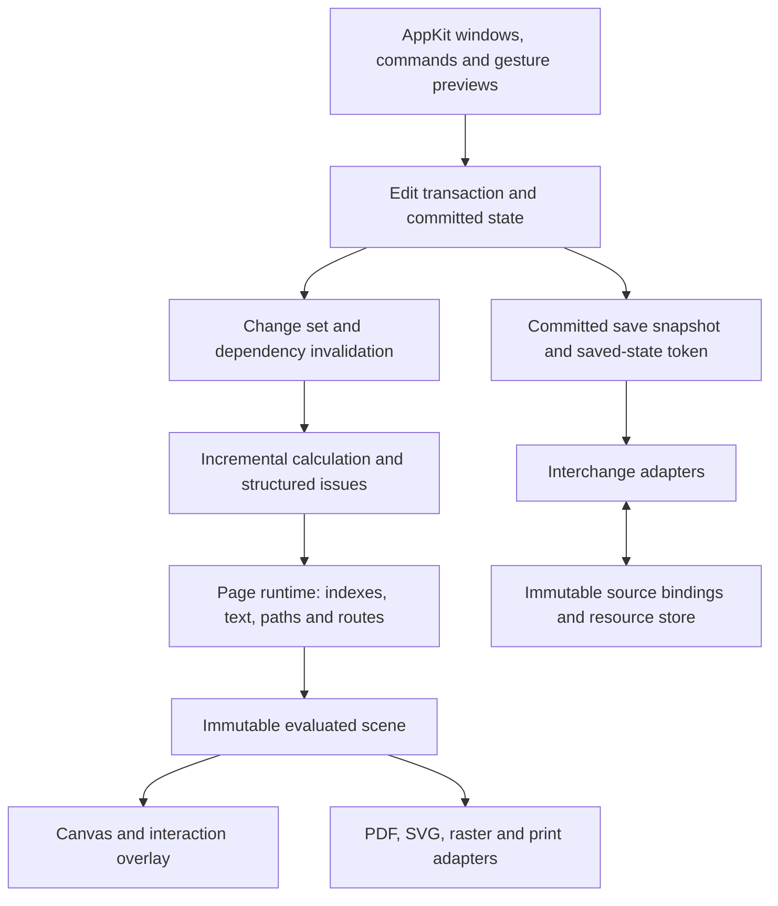

# MacVisio product and architecture review

16 October 2026 · Reviewed implementation: `c8a57458afd124b14c7b8e632108bffd388ab3f2` · Bundled app: 0.23.3, build 28

## Assessment

MacVisio has a useful native application foundation, substantial format-preservation work, and broad feature-level tests. Its internal architecture still behaves like a small drawing editor extended to cover a much larger product. Performance work has removed specific expensive operations, but ordinary interactions still enter paths whose cost depends on the entire page or document.

The lag is an architectural consequence of broad invalidation, synchronous calculation, repeated scene construction, and loosely separated document and interaction state. The review also found correctness and qualification gaps that matter as much as speed. Increasing feature breadth on these foundations will make both harder to control.

**Recommendation:** retain Swift/AppKit, the valuable interchange code, and the existing regression suite. Make a foundation milestone the next development priority: transactional state ownership, incremental calculation, retained rendering data, selective UI updates, and enforceable product-quality gates. The full Visio Professional 2019 objective remains the scope; these changes are prerequisites for delivering it reliably. There is no evidence here that changing UI frameworks or replacing the whole application would solve the underlying problems.

## Scope and evidence

This review covers the document shell, model and undo, interactions, rendering and text, calculation, routing, libraries, persistence and interchange, diagnostics, accessibility, testing, development structure, and distribution. It includes source tracing, the repository's history and qualification documents, current release profiling, a release-mode test run, and temporary diagnostic probes. It is an architectural assessment across the product, not an assertion that every Visio feature has been manually accepted.

The reviewed baseline contains 76 application Swift files and approximately 13,546 source lines in a single executable target. There are 56 existing Swift test files. A temporary extra test file was used for this review and removed from the test target afterward; its executed source remains in `build/ArchitectureReviewProbeTests.executed.swift`. This review changed no production source. The separately authored `PRODUCT-SPEC.md` draft appeared during the review; requirement mappings below refer to that draft and are not evidence of implemented behavior.

Concurrent working-tree changes to the welcome window, its tests and product-planning documents were present by delivery. Their diff was inspected: the Home layout becomes smaller and more adaptive, which improves that part of the product. Those in-progress changes are not part of the measured 0.23.3 bundle or the 454-test baseline results below. The fixed-pane observations in this review concern the drawing editor, whose layout is separate.

Measurements used an Apple M4 on macOS 27.0.1 and the existing local, compact-saved drawing with three pages containing 689, 2,030 and 3,909 shapes, plus 377 connectors in total. Timing artifacts contain counts and durations rather than drawing contents. They remain under the ignored `build/` directory because the representative drawing is local evidence, not a proposed public fixture.

The existing release profiler measured:

| Operation | Observed elapsed time |
| --- | ---: |
| Read drawing into model | 2.64 s |
| Selection plus full editor bitmap draw, initial active page | 123–127 ms |
| Insert plus draw, initial active page | 775 ms |
| Insert plus draw, page at index 1 | 735 ms |
| Insert plus draw, page at index 2 | 1,471 ms |
| Undo plus draw, page at index 2 | 234 ms |

The initial active page is the 2,030-shape page. The profiler leaves its first inserted shape present after Redo, so its later index-1 operation uses 2,031 shapes. These are single-run, compound timings, not frame rates or p95 measurements.

The separate stage probe measured each original page at 100% zoom. Drawing, hit-test and small-selection numbers below are medians of five runs after one warmup. Calculation and select-all timings are individual measurements.

| Work | 689 shapes | 2,030 shapes | 3,909 shapes |
| --- | ---: | ---: | ---: |
| Canvas viewport bitmap draw | 24.6 ms | 45.1 ms | 99.3 ms |
| Canvas draw for a 16 × 16 pixel rectangle | 16.7 ms | 37.2 ms | 92.4 ms |
| Select one shape, without drawing | 8.1 ms | 8.1 ms | 8.8 ms |
| Refresh editor, without drawing | 9.4 ms | 9.3 ms | 10.4 ms |
| Select all shapes, without drawing | 21.1 ms | 112.2 ms | 300.0 ms |
| Shape hit-test that misses | 2.0 ms | 7.2 ms | 18.4 ms |
| ShapeSheet work after inserting one basic shape | 222.7 ms | 567.5 ms | 1,312.2 ms |
| Text-field pass after that geometry work | 73.6 ms | 68.5 ms | 68.6 ms |

Each insertion calculation settled in one pass. Broad traversal is expensive even without repeated convergence passes. All connector routes together cost less than 1 ms on each measured page; routing is an architectural scaling concern, but **was not the dominant bottleneck in this drawing**.

Apple describes roughly 100 ms as a noticeable discrete-interaction delay and recommends much smaller main-thread work for continuous manipulation. The proposed acceptance budgets later in this report are product decisions, informed by [Apple's responsiveness guidance](https://developer.apple.com/documentation/xcode/improving-app-responsiveness).

## Foundations worth preserving

- **Native document application:** NSDocument, native controls, separate windows, native rich-text editing, menus and printing are appropriate foundations. `DocumentWorkflow` separates navigation from the Home window's presentation.
- **Preservation-aware interchange:** unchanged public parts are retained, supported edits patch source XML, and private metadata is checked against public hashes. That is much stronger than rebuilding every imported document from a reduced native model.
- **Bounded input handling:** ZIP size/entry limits, path validation, XML entity restrictions, formula/dependency bounds and legacy conversion limits already exist. These should remain central invariants.
- **Useful semantic code:** the shared expression parser, typed values, group/coordinate helpers, source ID allocation, and deterministic bounded orthogonal search are reusable assets.
- **Substantive regression work:** tests exercise undo, public output with private metadata removed, independent libvisio parsing, async saving, inherited shapes, units, text and compatibility migrations. The documentation is generally candid about the difference between parser coverage and actual Visio acceptance.
- **Release integrity controls:** dependencies are pinned; packaging checks signatures, dependencies, framework links, update signatures and archive integrity. The local Developer ID/notarization route is documented.

## Prioritized findings

P1 means a foundation or release-quality problem that deserves priority before broad feature expansion. P2 means an important scaling or maintainability problem to address as part of that foundation work. Evidence is identified as measured, reproduced, source-confirmed, or an unmeasured risk.

### 1. P1 — Committed document state, gesture previews and saved state need an explicit transaction contract

**Reproduced correctness defect.** `CanvasView.mouseDragged` writes tentative positions directly to `document.diagram`; Escape restores `beforeDrag` directly. Saving commits text editing but does not finish, exclude or otherwise distinguish an active drag. The serializer can therefore capture a gesture that the user later cancels.

The review probe created one rectangle at X=100, dragged it to X=150, saved, and pressed Escape. The resulting state was:

| State | Value |
| --- | ---: |
| Original X | 100 |
| Saved file X | 150 |
| Live model X after Escape | 100 |
| Document marked edited | false |

The file and visible document disagree while the application reports no unsaved change. An autosave occurring during a gesture has the same architectural exposure; that exact autosave schedule was not separately exercised.

**A separate saving concern remains unresolved.** The first full release-mode run executed 454 tests with one failure: `AsyncDocumentSaveTests.testNativeSaveUnblocksMainAndWritesCapturedDiagramSnapshot` reported that an edit made after snapshot capture was no longer marked dirty after save completion. One immediate focused rerun, ten further isolated reruns and a second full 454-test run passed. This is an intermittent, suite-context finding, not proof of a deterministic failure on every save. It still needs investigation before treating the saved-state contract as qualified.

**Required design:** keep a committed model and a separate interaction preview. A gesture creates one undoable transaction on commit; cancel discards only the preview. Every save captures an identified committed state. Completion acknowledges that captured state through NSDocument's change-count protocol without clearing newer changes. Explicitly decide what Save during an active gesture means and test it. Preserve correct undo-to-saved behavior as well as monotonically newer edits; a naive revision-number comparison alone is insufficient.

Code: [drag mutation](../Sources/MacVisio/CanvasView.swift#L272), [cancel](../Sources/MacVisio/CanvasView.swift#L350), [save snapshot](../Sources/MacVisio/Document.swift#L125), [existing save regression](../Tests/MacVisioTests/AsyncDocumentSaveTests.swift#L6). Apple's [save change-count documentation](https://developer.apple.com/documentation/appkit/nsdocument/updatechangecount%28withtoken%3Afor%3A%29) describes the framework contract to preserve. Draft requirements: MV-DOC-05/09, MV-NFR-01.

### 2. P1 — Calculation remains a synchronous page/document operation

**Measured and source-confirmed.** Every `MacVisioDocument.replace` synchronizes rich text and invokes `DiagramCalculation` synchronously before installing the edit. ShapeSheet skips unchanged pages, but recalculates eligible shapes throughout a changed page. Each invocation constructs fresh contexts, indexes, result caches and geometry paths. The convergence loop permits eight passes. Text fields still traverse all pages whenever any page has a field.

The measured insertion spends 223–1,312 ms in ShapeSheet and approximately 69–74 ms in text fields. Rich-text synchronization was only 2–3 ms and equality around 1.5–1.6 ms in the probe. Previous optimizations helped; they are not the main remaining costs on this fixture.

Control dragging is more severe structurally: every drag event calls `ControlEditing.moved`, which recalculates the entire input document to establish prior issues, recalculates the new document again, then validates it. Commit can invoke calculation again. This was source-confirmed; the representative drawing contains no control handles, so a large-document control-drag timing is not claimed.

**Required design:** edits produce explicit changed object/cell sets and dependency invalidations. Retain compiled expressions across immutable evaluations; retain evaluated results only with valid dependency keys. Calculate the affected dependency closure, including page, field, master, text-measurement and background-context dependencies. Model volatile/time functions and dynamic references explicitly, using conservative invalidation where dependency discovery is incomplete. Evaluate cyclic components with bounded, local convergence and retained diagnostics.

Cache the pre-gesture diagnostic baseline once. Reuse page indexes and a calculation context during control interaction. Keep long evaluation on bounded workers with revision checks, cancellation and defined pending-edit behavior; AppKit-backed text measurement requires its own audited execution policy. Merely wrapping the existing call in an asynchronous task would leave stale-result and undo-ordering problems.

Code: [replace](../Sources/MacVisio/Document.swift#L192), [calculation loop](../Sources/MacVisio/DiagramCalculation.swift#L5), [page skipping and traversal](../Sources/MacVisio/ShapeSheetEngine.swift#L29), [all-page fields](../Sources/MacVisio/TextFields.swift#L73), [control drag calculations](../Sources/MacVisio/ControlEditing.swift#L124). Draft: MV-NFR-02/04, specification sections 7.3–7.4.

### 3. P1 — Drawing lacks a retained scene and useful dirty-region rejection

**Measured and source-confirmed.** The rulers and grid use the dirty rectangle, but actual shapes, connectors and backgrounds are visited regardless of their intersection with it. Every pass reconstructs drawing order. Node drawing rebuilds paths, fonts, attributed strings and text measurements. Imported paths are constructed once for `outline` and again for individual path painting. A selection change invalidates the whole canvas.

On the largest page a 16 × 16 draw costs 92.4 ms versus 99.3 ms for the viewport. AppKit clipping saves pixel output; it does not avoid the application-side traversal and preparation. Even a viewport redraw on the smaller 689-shape page exceeds a typical 60 Hz frame interval.

There is also calculation inside rendering: `CanvasView.draw` calls `Diagram.scene`; a background with fields causes `scene` to run `TextFieldEngine.recalculate` over the document. That hidden dependency can make scrolling or selection invoke document-wide semantic work.

**Required design:** create immutable render snapshots after evaluation. Retain ordered render items, conservative visual bounds, paths and text layouts by revision. Painting reads prepared data and intersects item bounds with the actual dirty region. Bounds must account for rotated text, strokes, arrows, shadows and geometry extending outside a shape's nominal rectangle. Keep selection, handles, marquee and gesture previews in a lightweight overlay. Resolve foreground-specific background fields before painting and cache by both background and foreground context.

Start with Core Graphics/AppKit and measured caches. Introduce tiles or additional layer composition only if the retained renderer still misses budgets; measure bitmap memory before adopting either. [Apple's NSView drawing contract](https://developer.apple.com/documentation/appkit/nsview/draw%28_%3A%29) explicitly supports limiting work to dirty content.

Code: [canvas draw](../Sources/MacVisio/CanvasView.swift#L132), [unconditional objects](../Sources/MacVisio/CanvasView.swift#L188), [path/text construction](../Sources/MacVisio/Drawing.swift#L116), [scene calculation](../Sources/MacVisio/Model.swift#L173). Draft: MV-NFR-02/04, sections 7.3–7.4.

### 4. P1 — Hierarchy, selection, hit testing and routing need one indexed page runtime

**Measured and source-confirmed.** Parent visibility and locking repeatedly search the node array. Descendant expansion repeatedly filters it. Hit testing rebuilds outlines and scans in reverse source-array order. Snapping prepares all candidate bounds on each movement. Grouped-edge transformation reconstructs node and edge dictionaries during dragging. Selection-sensitive ribbon refresh expands the selection again.

Select-all without painting grew from 21 ms to 300 ms across the measured pages, and a miss hit-test reached 18.4 ms. `bringToFront` and `sendToBack` have a particularly avoidable multiplier: they call the computed `editableSelectionIDs` inside a filter over all nodes, recomputing selection/hierarchy work for each candidate.

Routing repeats endpoint lookups, builds a node map and scans potential obstacles per uncached orthogonal connector. The bounded search is a useful safeguard, but bounding one search does not bound the total event cost across all edges. Current measurements show that this is a risk for other document profiles, not the primary cause of this drawing's stalls.

**Required design:** a page runtime owns ID/index maps, parent/child adjacency, effective visibility/locking, drawing order, connector adjacency and a spatial index. Update these from transactions. Hit testing queries candidates using the same effective ordering as drawing; snap queries use nearby bounds. Cache routes by endpoint, port, obstacle and constraint revisions, with spatially conservative invalidation when obstacles move. Store derived data outside the interchange model.

Code: [visibility and hierarchy](../Sources/MacVisio/Model.swift#L124), [hit tests](../Sources/MacVisio/CanvasView.swift#L106), [snap/drag](../Sources/MacVisio/CanvasView.swift#L287), [grouped-edge maps](../Sources/MacVisio/DiagramOperations.swift#L92), [ordering commands](../Sources/MacVisio/Document.swift#L376), [router](../Sources/MacVisio/OrthogonalRouter.swift#L83).

### 5. P2 — UI refreshes recreate controls and content instead of applying a change

**Measured and source-confirmed.** Every committed edit refreshes page tabs, import notes, inspector, canvas size and status. Import-note refresh always requests layout. Root layout recreates page tabs and refreshes canvas size; stencil layout recreates the entire list. Inspector refresh removes and reconstructs its controls, except while a field is being edited. Marquee movement triggers inspector/ribbon work repeatedly. Stencil cards are eager views whose previews redraw full fragments.

The single-selection path costs about 8 ms before drawing, and general refresh 9–10 ms. This is smaller than calculation and painting, but already consumes a meaningful continuous-interaction budget. Large stencils add a separate allocation/layout scaling problem that was not quantified in this pass.

**Required design:** publish a typed change set: selection, geometry, text/style, page metadata, page list, compatibility, resource or document lifecycle. Update only dependent controls. Keep inspector controls alive, show mixed values and units, and avoid overwriting active edits. Reuse page tabs; invalidate canvas dimensions only when page geometry or zoom changes. Use reusable list/collection items for stencil libraries and cached thumbnails. Compute command availability once per selection revision.

Code: [editor refresh](../Sources/MacVisio/Document.swift#L257), [inspector rebuild](../Sources/MacVisio/EditorUI.swift#L165), [root layout/pages](../Sources/MacVisio/EditorUI.swift#L331), [stencil rebuild](../Sources/MacVisio/EditorUI.swift#L106), [ribbon selection](../Sources/MacVisio/VisioRibbonView.swift#L132).

### 6. P1 — Screen, export and calculation diagnostics do not share a complete presentation contract

**Source-confirmed rendering divergence.** `DiagramDrawing.drawContents` applies layer color and transparency overrides to shapes and connectors. The foreground canvas draws those objects directly without those overrides. Existing layer tests validate SVG/public round trips, so they do not establish foreground canvas correctness. A layer-colored drawing can therefore display differently from its exported representation. Intentional editing decorations such as selection handles can differ; layer semantics should not.

**Source-confirmed diagnostic gap.** Calculation issues are stored in `MacVisioDocument.calculationIssues`, but the visible compatibility button and notes use only `importWarnings`. The measured interaction run produced 31 calculation issues. Those calculation issues have no corresponding presentation path in the editor. String sets also discard the object/cell provenance users need to assess a cached or unsupported result.

**Required design:** screen and export consume the same evaluated scene with output-specific adapters. Separate display visibility from printability through explicit output policy. Represent diagnostics with page/shape/cell IDs, severity, affected capability, retained-cache status and a safe user action. Show material calculation and import issues in one navigable pane. Failed or nonconvergent evaluation must not quietly look like a fully current, reliable result.

Code: [layer-aware export drawing](../Sources/MacVisio/Drawing.swift#L206), [foreground canvas](../Sources/MacVisio/CanvasView.swift#L200), [issue storage](../Sources/MacVisio/Document.swift#L198), [visible notes](../Sources/MacVisio/EditorUI.swift#L363), [layer tests](../Tests/MacVisioTests/LayerSettingsTests.swift#L41). Draft: MV-UX-07, MV-NFR-08, compatibility section 6.

### 7. P1/P2 — Background work and resource ownership are only partly implemented

**Source-confirmed coverage gap.** VSDX/native opening and normal saving have background paths. Legacy VSD/VST, VSTX and stencil opening remain synchronous from UI actions. Legacy conversion waits for a subprocess and can take up to its 30-second timeout. Export work runs synchronously in the save-panel completion. Stencil loading even writes an intermediate package and imports it again. Moving normal Save off-main has therefore not made the product's I/O workflows consistently responsive.

**Measured loading cost and unmeasured memory risks.** Open profiling assigns 2.38 of 2.90 seconds to native metadata decoding. Package decompression was only 29 ms. The metadata loader initially parses JSON to inspect its envelope format, then the importer decodes the model; reducing duplicate object materialization is worth measuring. All package parts remain in memory along with the editable model and original page bindings. Source archives are also part of the broad `Equatable` document value.

Saving patches against the archive's original page bindings. A successful save does not install the new archive/bindings into the live document, so subsequent saves continue from the original baseline. That is a repeated-work concern, not a demonstrated data-loss defect. Save serialization also passes through temporary package files and whole-file `Data` objects. Snapshot undo uses Swift copy-on-write, so it would be inaccurate to say each edit eagerly copies every byte; changed arrays, retained histories and resource lifetimes still need measured budgets.

The image cache has no explicit cost/count limit, and its cost uses compressed resource bytes rather than estimated decoded pixels. No leak or out-of-memory result was measured in this review.

**Required design:** a bounded job service handles supported opens, conversions, library work and exports with progress/cancellation and snapshot ownership. Separate the immutable source package/resource store from document equality and render caches. Define budgets for decoded images, paths, text and undo history. Rebase preservation state after successful saves with revision-aware identity mappings. Profile allocations and repeated open/edit/save/close cycles before changing storage formats.

Code: [open paths](../Sources/MacVisio/main.swift#L125), [stencil loading](../Sources/MacVisio/EditorFeatures.swift#L65), [legacy process](../Sources/MacVisio/LegacyVisioFormat.swift#L32), [exports](../Sources/MacVisio/Document.swift#L443), [metadata](../Sources/MacVisio/NativeMetadataStorage.swift#L110), [source patch baseline](../Sources/MacVisio/VisioPreservation.swift#L10), [image cache](../Sources/MacVisio/Drawing.swift#L23).

### 8. P1 — Product qualification trails feature implementation

**Repository-confirmed.** The application contains many implemented slices, but actual Microsoft Visio open/edit/save/reopen acceptance remains absent. The existing Windows harness correctly records that its guest lacks a registered Visio installation. Importing every installer asset or parsing output with libvisio cannot establish formula behavior, master updates, theme fidelity, layout, specialist semantics or automation compatibility.

The current model represents a useful general editor, not yet the full domain needed by the stated target. In particular, native edges do not carry a full shape sheet and all foreign shape semantics; master identity/inheritance largely lives in interchange bindings rather than a first-class editable master system. Group parentage cannot also serve as container, lane, ordered-list and semantic relationship membership. Specialist solutions, external data refresh, validation rules and automation remain substantial product architecture work, as the compatibility matrix already acknowledges.

**Required design:** maintain independently evidenced capability records for preservation, rendering, editing, behavior and interchange. Establish the exact reference build and inventory, then qualify vertical workflows in both directions with private metadata removed from validation copies. Preserve unsupported source content without treating that as implemented behavior. Add explicit domain identities and extension boundaries for masters/styles, connector sheets, structured relationships, solution validation, data and automation before those features are scattered through canvas code.

This retains the full target. It changes development from accumulating UI/features toward completing and qualifying document workflows.

Evidence: [compatibility matrix](COMPATIBILITY.md), [original objective and remaining work](PLAN.md#L3), [Windows status](WINDOWS-VALIDATION.md), [current model](../Sources/MacVisio/Model.swift#L41), [source bindings](../Sources/MacVisio/VisioPackage.swift#L61). The product-spec draft's sections 6–10 give a useful proposed acceptance structure; they still require reference evidence.

### 9. P1 — Tests and releases need product-quality gates, not only successful feature checks

**Measured and source-confirmed.** The initial release-mode suite had one dirty-state failure among 454 tests; all seven Python tests passed. Isolated saving reruns passed, exposing a suite-context or timing sensitivity to investigate. Existing CLI profilers record single compound durations without regression thresholds. CI has functional/build/package checks, but no controlled release-performance corpus, memory slope gate, native accessibility journey or end-to-end update-install gate. Many UI tests call controllers directly; that is useful command testing, not a substitute for actual event routing and application journeys.

The release workflow can publish a build with the default ad hoc application signature. Sparkle signing authenticates update artifacts, but is independent of Developer ID/notarization. The verifier requires notarization when Developer ID is present, while accepting the ad hoc path. Documentation acknowledges this. The reviewed local published-style bundle is not thereby shown to be unsigned; the concern is the available public publishing route and its acceptance policy.

**Required practice:** make a stable-release manifest require the intended platform checks, Developer ID/notarization, trusted update/feed validation, and declared compatibility evidence. Keep a clearly separate development/test distribution path. Add controlled performance and recovery gates with retained artifacts, exercise a real update installation and recovery from interruption, and require a disposition for intermittent correctness failures rather than accepting an isolated green rerun.

Code/evidence: [CI](../.github/workflows/ci.yml), [release publishing](../.github/workflows/release.yml#L33), [default signing](../scripts/build-app.sh), [release verifier](../scripts/verify-release.py#L36), [distribution limitations](DISTRIBUTION.md#L33), [current profiler](../Sources/MacVisio/InteractionPerformance.swift). Draft: MV-OPS-01/02/03, MV-NFR-01/10.

### 10. P2 — Development boundaries and readability need to support the target product

**Source/history-confirmed; interpretation identified.** All application code, format code, examples and profilers compile into one executable target. `Document.swift` combines document lifecycle, saving, undo, controller construction and editing commands; `VisioFormat.swift` spans 1,674 lines of multiple concerns. There are 624 source lines longer than 200 characters. Important transaction and error behavior is often compressed into semicolon-separated statements. That makes ordering and invalidation harder to audit.

The history records substantial feature expansion alongside successive import, inspector, save and editing-stall fixes. Together with the current call graph, this supports the interpretation that development has been feature-led with localized performance repair. Commit cadence alone does not establish how carefully work was reviewed or who authored it.

The parser is already shared, which is good. Evaluation semantics and host-specific dispatch are nevertheless spread across scalar, typed, context and field engines. Further functions and specialist behavior need shared semantic contracts, not additional unrelated dispatch paths. Shape-local, parent, drawing, paper and screen coordinates are represented by broadly interchangeable numeric types, increasing the cost of safely maintaining scale and transform behavior.

**Required practice:** define logical boundaries first, then extract a small number of enforced modules: document/model transactions; calculation; rendering/text; interchange/resources; AppKit shell. Keep dependency direction explicit. Separate fixtures, generators and profiling tools from the production entry point. Format critical code and adopt an automated formatter, exhaustive typed states, assertions for invariants and structured diagnostics. Add unit-aware coordinate wrappers where they prevent real mistakes. Use shared function definitions and host contexts with differential tests. Avoid a large protocol framework or module-per-file reorganization.

The development definition of done should include one meaningful end-to-end fixture, invalidation effects, undo/save behavior, performance impact, compatibility status and independent evidence appropriate to the feature. Documentation should identify current contracts and decisions separately from historical release narratives.

Code: [package targets](../Package.swift#L12), [document responsibilities](../Sources/MacVisio/Document.swift), [format implementation](../Sources/MacVisio/VisioFormat.swift), [calculation context](../Sources/MacVisio/ShapeSheetContext.swift), [CLI/tools in entry point](../Sources/MacVisio/main.swift#L241).

### 11. P2 — Native usability and accessibility need whole-workflow acceptance

**Source-confirmed gaps; no complete VoiceOver or usability study was performed.** Native controls have useful labels and several keyboard actions are implemented. The canvas exposes its own label/identifier, but does not provide a semantic accessibility tree for its drawn shapes, connectors, properties and relationships. Toolbar labels alone do not make a diagram editable through VoiceOver.

Fixed-width side panes and manual frame layouts, eager lists, modal advanced editors, first-selected-object inspector values, and page switching that always fits the page need evaluation against sustained editing workflows. The current source supports a native application, but does not establish that a keyboard-only user can create, connect, format, inspect and export a diagram. Shape focus/reading order, mixed values, explicit units, zoom/page-state retention, cancellation and error recovery need coherent policies.

**Required practice:** implement accessible scene elements backed by the same IDs and spatial data as hit testing. Define keyboard navigation, focus and connection workflows. Qualify complete journeys on representative window sizes and supported platforms, including text editing, multiple documents, recovery and missing fonts/files. Make panes adaptable where that helps the drawing workspace. Publish a bundle-derived support matrix: a macOS 13 source target is not proof that the bundled macOS 27 legacy dependencies run there.

Code/evidence: [canvas accessibility](../Sources/MacVisio/CanvasView.swift#L59), [window sizing](../Sources/MacVisio/Document.swift#L225), [fixed editor layout](../Sources/MacVisio/EditorUI.swift#L331), [page switching](../Sources/MacVisio/Document.swift#L426), [support declaration](../README.md). Draft: MV-ACC-01/02/03, MV-UX-01/05/08, MV-NFR-10.

## Target architecture

The central change is to make preparation explicit and reusable. The UI owns presentation and gestures; the document owns committed state; engines prepare identified derived results.

Contracts that should be enforceable in code and tests:

1. Painting and hit testing do not evaluate formulas, parse files, or mutate the document.
2. Selection, zoom and gesture previews do not trigger semantic recalculation.
3. Every committed edit has an affected set, one undo contract, stable identities and an invalidation result.
4. A calculation/route/job result identifies its inputs and cannot overwrite a newer incompatible state.
5. Saves acknowledge exactly their committed snapshot; failure preserves both the last valid destination and unsaved state.
6. Cached paths, text, styles, routes and diagnostics have explicit dependency keys and budgets.
7. Screen and export share semantics, while editing decorations and output policies remain explicit.
8. Unsupported content has a preservation and editing policy, with object-level diagnostics.

Keep these boundaries logical until their interfaces stabilize; then use Swift targets to enforce them. Separate pure calculations from AppKit text/font operations before moving expensive work to workers. Audit Sendable/actor isolation incrementally rather than claiming that all value-model work is automatically safe to run concurrently.

## Development and qualification changes

The current tests should become the regression floor. Add evidence that measures the product's actual promises:

| Qualification layer | Required evidence |
| --- | --- |
| Model/transaction | Undo/redo, cancel, identity, dependency invalidation and saved-state invariants across mixed operations |
| Calculation | Accepted reference semantics; affected-closure checks; unsupported/volatile/cyclic cases; equality with conservative full evaluation on a suitable corpus |
| Rendering | Same evaluated scene across canvas/export; conservative visual bounds; dirty-region work counts; reference images with explicit font/tolerance policy |
| Interaction | Real event routing for drag, resize, control handles, marquee, text, zoom/pan, keyboard and multiple windows |
| Persistence | Save during edits/gestures; overlapping saves; undo-to-saved; disk/permission failure; interrupted recovery; external modification; legacy/template/stencil paths |
| Performance | Release-mode p50/p95/max, main-loop gaps, allocations/RSS, evaluated-cell and drawn-item counts, cold/warm conditions and scaling curves |
| Compatibility | Bidirectional Microsoft Visio workflows with public content independently inspected; unsupported cases remain explicitly unresolved |
| Release | Installed supported-platform smoke tests, signatures/notarization, real update installation, recovery and accessibility journeys |

Use a versioned public synthetic corpus for 100/1,000/5,000/20,000 shapes, plus deeper hierarchy, many uncached connectors, text/formula-heavy and image-heavy cases. Add permissioned real documents through a separate confidential fixture path. Preserve the current synthetic-only Windows harness's input restrictions rather than silently feeding it customer files.

Include long undo histories, repeated save cycles, twenty open/edit/close cycles and multiple open documents. A flat 20,000-rectangle document is not a substitute for a 5,000-shape intelligent drawing. Require small-edit work to track the affected set and viewport work to track visible content, allowing documented conservative fallbacks.

Add signposted stages for event handling, transaction application, evaluation, scene preparation, text layout, routing, drawing, snapshot creation and encoding. Track work counts as well as milliseconds so algorithmic regressions are visible on noisy machines. Use [XCTest's performance metrics](https://developer.apple.com/documentation/xctest/performance-tests) for elapsed time, CPU, memory and signposted work. Run functional checks on ordinary CI; run absolute latency gates on controlled hardware, with scaling/work-count checks available on shared runners.

The product-spec draft proposes 30 samples per fixture/cache condition and named hardware for p95 qualification. This review's five-run medians and single-run timings establish bottlenecks; they do not qualify those release targets.

## Staged remediation plan

| Stage | Concrete work | Exit evidence |
| --- | --- | --- |
| 1. Establish correctness and measurement contracts | Investigate suite-context save failure; separate gesture previews; specify save/undo/cancel states; retain public benchmark fixtures and signposts | Save/cancel mismatch closed; dirty-state/recovery cases pass repeatedly in isolation and suites; measured baseline retained |
| 2. Introduce transactions and page runtime | Explicit change sets, identity/index ownership, parent/child and connector adjacency, spatial queries, selective presentation events | Selection/zoom never calculate; hit tests use current draw order; small edits update bounded indexes; existing interchange/undo regressions pass |
| 3. Retain evaluated rendering data | Shared scene; path/text caches; dirty-region rejection; lightweight overlays; persistent inspector/tabs; reusable stencil list | Dirty-rectangle work-count tests; canvas/export layer agreement; smooth measured gesture traces; bounded cache growth |
| 4. Make calculation incremental | Dependency graph and volatility policy; reusable expression/context data; localized convergence; control-gesture baseline; revision-safe long jobs | Small edit avoids unrelated page/cell work; conservative full-evaluation comparison passes; text/background contexts and cycles stay correct |
| 5. Complete I/O, resource and lifecycle policy | Bounded/cancellable format jobs, export snapshots, save-baseline rebasing, resource/undo budgets, recovery/conflict tests | UI heartbeat during every supported long workflow; failure/cancel leaves valid state; repeated cycles satisfy declared memory budgets |
| 6. Qualify native product and distribution | Accessibility journeys, support matrix, trusted stable-release gate, real updater installation, reference Visio workflows | Traceable G1/G2-style acceptance pack; no known silent-loss defect; public claims match completed evidence |
| 7. Resume broad baseline expansion on these contracts | First-class masters/connector sheets/relationships; solution, data and automation boundaries; independent vertical acceptance packs | Each added capability completes its UI/model/calculation/interchange/reference workflow without regressing the fixed corpus |

Stages overlap where safe. Establish the actual Visio reference environment and inventory alongside stages 1–2 because it informs domain decisions. Retained rendering and incremental calculation share the page runtime; neither should wait for a speculative complete replacement of the other.

Adopt the draft specification's numerical targets only after agreement on representative fixtures and supported hardware. As an engineering budget, aim for approximately 5 ms of application main-thread preparation during continuous manipulation and comfortably under 100 ms for discrete feedback. Longer operations need prompt progress and cancellation. The initial milestone is measured correctness and a responsive representative workload, followed by the larger declared corpus; no delivery-date or full-parity estimate follows from this audit.

## Evidence artifacts and remaining checks

All paths below are relative to the repository root:

| Artifact | Meaning |
| --- | --- |
| `build/architecture-review-interactions.json` | Current bundled release's compound interaction timings |
| `build/architecture-review-open.json` | Open-stage breakdown |
| `build/architecture-review-stages.json` | Per-page drawing, selection, hit tests, routing and calculation probe |
| `build/architecture-review-drag-save.json` | Reproduced canceled-drag/save inconsistency |
| `build/ArchitectureReviewProbeTests.executed.swift` | Executed temporary probe source |
| `build/architecture-review-tests.log` | Initial full release-mode run: 454 tests, one dirty-state failure |
| `build/architecture-review-save-repeat1.log` | Immediate isolated rerun: passed |
| `build/architecture-review-save-repeats.json` | Ten additional isolated dirty-state checks: all passed |
| `build/architecture-review-tests-repeat.log` | Second full release-mode run: all 454 tests passed |
| `build/architecture-review-python-tests.log` | Seven script tests: passed |

The review does not establish p95/frame pacing, peak memory/leak behavior, complete VoiceOver use, actual Microsoft Visio acceptance, crash recovery qualification, or installed-update success. These are explicit qualification work in the plan, not reasons to defer the source-confirmed foundation changes. Performance measurements identify more than one bottleneck and should be retained as evidence, not treated as the full product acceptance suite.
