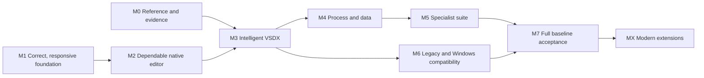

# MacVisio development backlog and work packages

Version 1.1 · 16 October 2026 · Status: proposed execution plan

**9 milestones, 39 work packages and 161 initial tasks**, covering all 154 specification requirements: 148 baseline/native obligations and six extensions. Large catalog and specialist tasks require child decomposition; the initial task count is not the total effort or an exhaustive runtime inventory.

**Recommended next engineering milestone: M1 — correct, responsive editing foundation.** Start M0 reference/discovery alongside it. The architecture review reports a reproduced cancelled-drag/save mismatch, an intermittent saved-state test failure, synchronous broad calculation and unnecessary scene/UI reconstruction. Those findings take priority over adding more specialist features.

This backlog plans work only. It does not implement features, install/activate Visio, publish issues, start services or release a build. Existing implemented slices are preserved and qualified; they are not scheduled for automatic replacement. Concurrent welcome-window/product changes remain separate.

The earlier feature snapshot describes local implementation presence. The later architecture review identifies correctness defects within some of those implemented workflows, notably gesture/save state. Those labels are not acceptance: the backlog requires defect closure and qualification before release.

Sources: [specification](PRODUCT-SPEC.md), [requirements](product-requirements.json), [feature snapshot](FEATURE-STATUS.md), [architecture review](ARCHITECTURAL-REVIEW.md), [existing plan](PLAN.md), [compatibility](COMPATIBILITY.md) and [Windows reference notes](WINDOWS-VALIDATION.md). The [machine-readable backlog](development-backlog.json) contains the same package/task/dependency/coverage data.

M1 implementation candidate `7db0a8b` is locally qualified on `codex/m1-editing-foundation`: 23 bounded task contributions pass; WP-05-T04 recovery and WP-08-T05 native event qualification remain unaccepted. The [qualification record](delivery/M1-QUALIFICATION.md) and [task ledger](delivery/M1-TASK-EVIDENCE.json) retain evidence and limits. M1 acceptance remains false; this does not release the M2 acceptance dependency.

The architecture review is integrated through the finding-to-task ledger and eight acceptance contracts in [section 10](#10-integrated-architecture-review). All 11 findings remain open against the reviewed baseline; current local contributions have separate scope and evidence below. The existing 39 packages and 161 tasks are retained. Route-cache invalidation, nearby snapping, active-gesture save policy, text-layout instrumentation and formatter/tooling boundaries are made explicit within their existing tasks.

## 1. Planning and scope rules

- Retain the full Visio Professional 2019 target, including binary VSD/VSDX and confirmed Windows-dependent functions. Native equivalents do not prove script/add-in compatibility.
- Milestones are outcome-based releases/checkpoints, not dates. G1/G2/G3 candidates do not automatically close a specification gate: every applicable acceptance criterion still needs evidence. G4/full parity is reserved for M7.
- M0 and M1 can run alongside each other. A missing Visio reference blocks independent compatibility qualification, not useful local correctness or architecture work.
- Full-package implementation depends on the listed delivery dependencies. Contract/design/probe tasks may start when their inputs exist; do not treat tentative APIs as completed dependencies. Within a package, listed task dependencies are conservative and can be refined after design.
- Qualification dependencies are separate: local implementation may finish while Visio evidence remains pending. Such work is implemented/unaccepted, not complete compatibility.
- M6 implementation can proceed after M3 while M4/M5 family work progresses. All baseline obligations remain required for M7.
- MX is deliberately after M7 in the default plan. Earlier extension scheduling requires an explicit priority decision and must not remove baseline work.
- P0 is a correctness/foundation/qualification/release blocker; P1 is mandatory baseline/native delivery; P2 is an optional extension. These are scheduling priorities, not promises about severity of every future defect.
- S/M/L are relative complexity only: bounded, cross-layer, and multi-slice/uncertain respectively. Every L item must split into reviewable child tasks before implementation. No duration, story-point total or delivery date is supported yet.
- Task requirement lists initially express package scope. Refinement must assign exact children to individual requirements/inventory entries; broad shared mappings are not sufficient acceptance evidence.

## 2. Milestone roadmap

| Milestone | Outcome | Packages | Specification relationship | Exit evidence |
| --- | --- | --- | --- | --- |
| M0 — Reference, inventory and evidence foundation | Know the target surface and obtain repeatable independent evidence. | WP-01, WP-02, WP-03, WP-04 | G0 | A licensed exact-build reference launches and the harness completes a small real Visio round trip. Every known baseline inventory entry maps to a requirement and an executable check or unresolved prerequisite. Public benchmarks, five-dimension evidence ledger and high-risk feasibility decisions are retained. |
| M1 — Correct, responsive editing foundation | An edit, cancelled gesture, save and undo have consistent state; ordinary interactions update bounded work. | WP-05, WP-06, WP-07, WP-08, WP-09 | Foundation prerequisite; supports G1/G2 | The reproduced cancelled-drag/save mismatch is closed and intermittent saved-state behavior has a disposition. Transactions, page indexes, retained scene and incremental calculation satisfy their work-count invariants. Long jobs are revision-safe/cancellable and resource/undo budgets have measured evidence. |
| M2 — Dependable native editor release | Create, edit, recover, inspect and publish a basic drawing through complete native journeys. | WP-10, WP-11, WP-12, WP-13 | G1 candidate | Native document, find/command, keyboard/VoiceOver and basic-flowchart journeys pass. Recovery/conflict/security and trusted distribution/update-install checks pass for the declared platform. Material import/calculation issues are visible and release claims match the accepted slice. |
| M3 — Intelligent VSDX professional drawing | Reuse intelligent shapes and exchange the declared VSDX drawing slice with Visio. | WP-14, WP-15, WP-16, WP-17, WP-18, WP-19, WP-20 | G2 candidate | The registered master/formula/text/theme/geometry/connector/page workflows pass public-content round trips. Screen/export/print agree under explicit layer/output policy and defined physical dimensions. All remaining catalog/version gaps stay visible; no private metadata is needed for a claimed public capability. |
| M4 — Process modeling and data workflows | Build structured processes, validate them, link data and publish operational reports. | WP-21, WP-22, WP-23, WP-24 | G3 process/data slice | Container/list/swimlane and BPMN journeys pass membership, undo, layout and exchange checks. Mapped data import, keyed links, refresh/conflict preview, graphics and reports reconcile correctly. Source-specific connectors publish tested prerequisites and user data stays protected. |
| M5 — Specialist professional diagram suite | Complete the inventoried business, software, infrastructure, schedule and engineering solutions. | WP-25, WP-26, WP-27, WP-28, WP-29 | G3 specialist slice | Each applicable solution family has named child tasks and a complete UI/model/calculation/interchange acceptance pack. CAD/database source version matrices and exact-build applicability are recorded. Imported template graphics are not counted as completed solution behavior. |
| M6 — Legacy formats and Windows-dependent compatibility | Complete the declared binary/legacy, automation, object and integration workflows. | WP-30, WP-31, WP-32, WP-33 | G4 compatibility candidate | Declared VSD/VSS/VST/XML filters pass semantic round trips; VSD remains experimental until evidence passes. Confirmed automation, add-in, OLE, protected-file and baseline integration obligations have passing support paths. Any infeasible obligation is escalated as an explicit scope decision and prevents a full-parity claim. |
| M7 — Full baseline qualification and release | Accept and release the complete frozen Visio Professional 2019 compatibility scope. | WP-34, WP-35 | G4 final; all applicable G0–G4 criteria | All 148 baseline/native specification requirements and expanded applicable inventory entries have evidence or explicitly approved scope changes. No unresolved material compatibility exception, known silent-loss defect or undiagnosed release-blocking intermittent failure remains. Full native, security, performance, recovery, platform, install/update and bidirectional Visio packs pass on the frozen release. |
| MX — Contemporary extensions | Add selected modern content, table generation, integrations and native collaboration. | WP-36, WP-37, WP-38, WP-39 | GX | Each selected extension passes its own API/version/security/product evidence. Baseline qualification does not regress and Microsoft coauthoring is never inferred from file sync. |

M0 reference/inventory and M1 local engineering start together. The arrows show delivery checkpoints, not a prohibition on early risk discovery or contract design.

## 3. Work-package index

| Package | Milestone | Work package | Priority | Proposed owner role | Risk | Delivery dependencies | Qualification prerequisites | Tasks |
| --- | --- | --- | --- | --- | --- | --- | --- | ---: |
| [WP-01](#wp-01) | M0 | Establish the Visio reference environment | P0 | Compatibility/QA | High | None | Local evidence; global release gates apply | 4 |
| [WP-02](#wp-02) | M0 | Build the scope, coverage and decision ledger | P0 | Product/Compatibility | High | None | WP-01 | 4 |
| [WP-03](#wp-03) | M0 | Create the qualification harness and benchmark corpus | P0 | QA/Performance | High | None | WP-01 | 5 |
| [WP-04](#wp-04) | M0 | Resolve high-risk compatibility approaches early | P0 | Architecture/Interchange | High | None | WP-01 | 4 |
| [WP-05](#wp-05) | M1 | Fix committed state, gesture, undo and save semantics | P0 | Native/Core | High | None | Local evidence; global release gates apply | 5 |
| [WP-06](#wp-06) | M1 | Introduce indexed page runtime and transaction boundaries | P0 | Core/Architecture | High | WP-05 | Local evidence; global release gates apply | 5 |
| [WP-07](#wp-07) | M1 | Make calculation incremental and revision-safe | P0 | Calculation | High | WP-06 | Local evidence; global release gates apply | 5 |
| [WP-08](#wp-08) | M1 | Retain rendering state and update UI selectively | P0 | Rendering/Native UI | High | WP-06 | Local evidence; global release gates apply | 5 |
| [WP-09](#wp-09) | M1 | Unify long jobs, resources and document lifecycle | P0 | Core/I-O | High | WP-05, WP-06 | Local evidence; global release gates apply | 5 |
| [WP-10](#wp-10) | M2 | Finish document UX, search and basic authoring | P1 | Native/Product UX | Medium | WP-05, WP-06, WP-09 | Local evidence; global release gates apply | 4 |
| [WP-11](#wp-11) | M2 | Complete accessible input and rich-text journeys | P1 | Accessibility/Text UI | High | WP-06, WP-08, WP-10 | Local evidence; global release gates apply | 4 |
| [WP-12](#wp-12) | M2 | Enforce secure, trusted product distribution | P0 | Release/Security | High | WP-05, WP-09 | Local evidence; global release gates apply | 4 |
| [WP-13](#wp-13) | M2 | Expose compatibility and calculation issues | P0 | Native/Compatibility | High | WP-02, WP-06, WP-07, WP-08 | Local evidence; global release gates apply | 4 |
| [WP-14](#wp-14) | M3 | Make masters, connector sheets and relationships first-class | P1 | Core/Interchange | High | WP-06, WP-07, WP-09 | WP-01, WP-03 | 4 |
| [WP-15](#wp-15) | M3 | Complete ShapeSheet semantic slices | P1 | Calculation/Compatibility | High | WP-02, WP-07, WP-14 | WP-01, WP-03 | 4 |
| [WP-16](#wp-16) | M3 | Complete advanced text, fields and presentation | P1 | Text/Rendering | High | WP-07, WP-08, WP-11, WP-14 | WP-01, WP-03 | 4 |
| [WP-17](#wp-17) | M3 | Complete geometry, protections, themes and effects | P1 | Geometry/Rendering | High | WP-07, WP-08, WP-14 | WP-01, WP-03 | 4 |
| [WP-18](#wp-18) | M3 | Complete connector behavior and automatic layout | P1 | Connections/Layout | High | WP-06, WP-07, WP-08, WP-14 | WP-01, WP-03 | 4 |
| [WP-19](#wp-19) | M3 | Complete pages, layers, scale, export and printing | P1 | Native/Publication | High | WP-08, WP-09, WP-14, WP-16, WP-17 | WP-01, WP-03 | 4 |
| [WP-20](#wp-20) | M3 | Complete stencil/template authoring and VSDX preservation | P1 | Libraries/Interchange | High | WP-09, WP-14, WP-15, WP-16, WP-17, WP-18 | WP-01, WP-03 | 4 |
| [WP-21](#wp-21) | M4 | Implement containers, ordered lists and swimlanes | P1 | Solutions/Layout | High | WP-14, WP-18 | WP-01, WP-03 | 4 |
| [WP-22](#wp-22) | M4 | Implement validation engine and BPMN solution | P1 | Solutions/Validation | High | WP-15, WP-18, WP-21 | WP-01, WP-03 | 4 |
| [WP-23](#wp-23) | M4 | Implement typed external data, adapters and refresh | P1 | Data/Integration | High | WP-04, WP-09, WP-14, WP-15 | WP-01, WP-03 | 5 |
| [WP-24](#wp-24) | M4 | Implement data graphics, legends and reports | P1 | Data/Publication | Medium | WP-19, WP-21, WP-23 | WP-01, WP-03 | 4 |
| [WP-25](#wp-25) | M5 | Deliver organization and schedule solutions | P1 | Solutions/Business | High | WP-18, WP-21, WP-23, WP-24 | WP-01, WP-03 | 4 |
| [WP-26](#wp-26) | M5 | Deliver UML, ERD and database schema workflows | P1 | Solutions/Software | High | WP-04, WP-15, WP-16, WP-18, WP-22, WP-23 | WP-01, WP-03 | 4 |
| [WP-27](#wp-27) | M5 | Deliver network, rack and baseline cloud solutions | P1 | Solutions/Infrastructure | High | WP-18, WP-20, WP-23, WP-24 | WP-01, WP-03 | 4 |
| [WP-28](#wp-28) | M5 | Deliver CAD, floor-plan and engineering solutions | P1 | Solutions/Engineering | High | WP-04, WP-17, WP-19, WP-20, WP-23 | WP-01, WP-03 | 4 |
| [WP-29](#wp-29) | M5 | Deliver remaining business, quality and wireframe solutions | P1 | Solutions/Business | High | WP-20, WP-21, WP-22, WP-24 | WP-01, WP-03 | 4 |
| [WP-30](#wp-30) | M6 | Complete binary and legacy public format semantics | P1 | Interchange | High | WP-04, WP-14, WP-15, WP-16, WP-17, WP-18, WP-20 | WP-01, WP-03 | 4 |
| [WP-31](#wp-31) | M6 | Deliver automation API and VBA/COM compatibility | P1 | Automation/Architecture | High | WP-04, WP-06, WP-09, WP-14, WP-15, WP-20 | WP-01, WP-03 | 4 |
| [WP-32](#wp-32) | M6 | Deliver foreign objects, add-ins, macro and protection support | P1 | Platform/Interchange | High | WP-04, WP-12, WP-30, WP-31 | WP-01, WP-03 | 4 |
| [WP-33](#wp-33) | M6 | Deliver baseline review, sharing and Office integrations | P1 | Integration/Review | High | WP-04, WP-23, WP-24, WP-31, WP-32 | WP-01, WP-03 | 4 |
| [WP-34](#wp-34) | M7 | Close full baseline and product-quality acceptance | P0 | Independent QA/Compatibility | High | WP-02, WP-03, WP-10, WP-11, WP-12, WP-13, WP-20, WP-22, WP-24, WP-25, WP-26, WP-27, WP-28, WP-29, WP-30, WP-31, WP-32, WP-33 | WP-01, WP-03 | 4 |
| [WP-35](#wp-35) | M7 | Package and release the qualified baseline | P0 | Release/Product | High | WP-12, WP-34 | Local evidence; global release gates apply | 4 |
| [WP-36](#wp-36) | MX | Refresh modern cloud/content libraries | P2 | Content/Infrastructure | Medium | WP-20, WP-27, WP-35 | Local evidence; global release gates apply | 3 |
| [WP-37](#wp-37) | MX | Generate and synchronize diagrams from tables | P2 | Data/Product | High | WP-18, WP-21, WP-23, WP-24, WP-35 | Local evidence; global release gates apply | 4 |
| [WP-38](#wp-38) | MX | Add contemporary Microsoft service integrations | P2 | Integration | High | WP-23, WP-31, WP-33, WP-35 | Local evidence; global release gates apply | 3 |
| [WP-39](#wp-39) | MX | Build native collaborative editing | P2 | Collaboration/Distributed Systems | High | WP-05, WP-06, WP-09, WP-31, WP-35 | Local evidence; global release gates apply | 4 |

Owner roles are proposed accountabilities, not named assignees or a headcount plan. Every package is Proposed; existing capability is recorded in the feature snapshot.

## 4. Work packages and task backlog

### WP-01 — Establish the Visio reference environment

**Milestone:** M0 · **Priority:** P0 · **Owner:** Compatibility/QA · **Risk:** High · **Status:** Proposed

**Readiness:** Ready to inspect; installation externally constrained.

**Outcome:** A reproducible, licensed Professional 2019 reference and recorded prerequisite matrix.

**Delivery dependencies:** None. **Qualification prerequisites:** Local acceptance plus applicable overall release gates.

**Requirement scope:** MV-REF-01.

**Architecture findings:** AR-08 (numbered findings in the [review](ARCHITECTURAL-REVIEW.md)).

**Package exit:** Freeze build/edition/OS/locale/fonts; application launch, COM activation and one isolated fixture round trip pass.

| Task | Work / deliverable | Acceptance | Size | Depends on |
| --- | --- | --- | --- | --- |
| WP-01-T01 — Reinspect the existing guest and installation evidence | Capture current guest/Visio/COM state and supported installation options without changing existing user sessions. | A dated inventory distinguishes observed state from old reports. | S | Package prerequisites |
| WP-01-T02 — Resolve and document reference installation | Install the appropriately licensed reference through a supported path; record exact build and data/solution prerequisites. | Visio launches; 32/64-bit automation and required fonts are verified. | L | WP-01-T01 |
| WP-01-T03 — Freeze and restore the reference image | Record restore procedure, environment manifest and reproducible harness setup. | A restored environment runs the same known-good reference fixture. | M | WP-01-T02 |
| WP-01-T04 — Run the first real acceptance smoke | Execute the existing synthetic-only harness and inspect produced files/exports. | Open, inspect, edit, save, close, reopen and export pass; repair prompts are captured. | M | WP-01-T03 |

### WP-02 — Build the scope, coverage and decision ledger

**Milestone:** M0 · **Priority:** P0 · **Owner:** Product/Compatibility · **Risk:** High · **Status:** Proposed

**Readiness:** Ready for documentation-led inventory; runtime inventory pending WP-01.

**Outcome:** One traceable baseline inventory, five-dimension evidence ledger and expansion process.

**Delivery dependencies:** None. **Qualification prerequisites:** WP-01.

**Requirement scope:** MV-REF-02, MV-REF-04, MV-REF-05, MV-SHS-11.

**Architecture findings:** AR-08, AR-09 (numbered findings in the [review](ARCHITECTURAL-REVIEW.md)).

**Package exit:** Every known entry has applicability, owner, requirement, fixture and evidence state; unknowns remain counted.

| Task | Work / deliverable | Acceptance | Size | Depends on |
| --- | --- | --- | --- | --- |
| WP-02-T01 — Import the existing requirements and feature snapshot | Create stable linked records for 154 requirements and current evidence without upgrading statuses. | All requirement IDs and snapshot states reconcile exactly. | S | Package prerequisites |
| WP-02-T02 — Inventory runtime surfaces and prerequisites | Catalog commands, solutions, masters, cells/functions, filters, APIs/events and integrations by exact build. | Observed/documented/unresolved applicability is distinct; unavailable runtime work stays pending. | L | WP-02-T01 |
| WP-02-T03 — Define compatibility evidence and scope decisions | Represent preservation/rendering/editing/behavior/interchange plus scope-change decisions. | A parser-only success cannot mark full compatibility; exclusions need an explicit decision record. | M | WP-02-T02 |
| WP-02-T04 — Expand uncovered catalog entries into child backlog | Create one semantic workflow/member case per inventory entry and link it to work packages. | No newly found baseline item disappears from coverage or is mislabeled extension. | L | WP-02-T03 |

### WP-03 — Create the qualification harness and benchmark corpus

**Milestone:** M0 · **Priority:** P0 · **Owner:** QA/Performance · **Risk:** High · **Status:** Proposed

**Readiness:** Ready for local corpus/instrumentation; Visio evidence requires WP-01.

**Outcome:** Versioned public fixtures and independent semantic, visual, fault and performance evidence.

**Delivery dependencies:** None. **Qualification prerequisites:** WP-01.

**Requirement scope:** MV-REF-03, MV-NFR-02, MV-NFR-03, MV-NFR-04, MV-NFR-05, MV-NFR-06, MV-NFR-07, MV-NFR-08, MV-NFR-09.

**Architecture findings:** AR-01, AR-02, AR-03, AR-09 (numbered findings in the [review](ARCHITECTURAL-REVIEW.md)).

**Package exit:** Harness preserves phase failures and records named hardware/cache state, work counts and p50/p95/max.

| Task | Work / deliverable | Acceptance | Size | Depends on |
| --- | --- | --- | --- | --- |
| WP-03-T01 — Capture reproducible correctness/performance baselines | Retain the architecture findings and create public 100/1,000/5,000/20,000-object variants including formulas/images/hierarchy. | No confidential content enters public fixtures; observed and target metrics stay separate. | M | Package prerequisites |
| WP-03-T02 — Instrument product stages and work counts | Record event, commit, calculation, scene, route, draw, snapshot and encoding stages. Distinguish text-layout and scene-preparation stages from drawing and calculation. | Small-change/dirty-region tests expose visited/evaluated/drawn objects independently of timing. Signposts separate text measurement, scene preparation and real event-loop gaps. | M | WP-03-T01 |
| WP-03-T03 — Extend bidirectional public-content comparison | Expand the existing synthetic-only harness for cells, masters, data/glue, graphics and both directions. | Private metadata is removed only from validation copies; reference phase failures remain visible. | L | WP-03-T02 |
| WP-03-T04 — Add repeatable performance and fault runners | Run at least 30 samples per defined fixture/cache condition and include save/recovery/memory cycles. | Controlled hardware runs absolute gates; shared CI checks work-count/scaling invariants. | L | WP-03-T03 |
| WP-03-T05 — Publish evidence manifests and confidentiality policy | Document expected outcomes, artifacts, hashes, versioning and a separate permissioned private-fixture path. | Existing synthetic-only safety restrictions remain enforced. | M | WP-03-T04 |

### WP-04 — Resolve high-risk compatibility approaches early

**Milestone:** M0 · **Priority:** P0 · **Owner:** Architecture/Interchange · **Risk:** High · **Status:** Proposed

**Readiness:** Ready to design probes; reference execution requires WP-01.

**Outcome:** Evidence-backed implementation approaches for legacy formats and Windows-dependent obligations.

**Delivery dependencies:** None. **Qualification prerequisites:** WP-01.

**Requirement scope:** MV-IO-02, MV-IO-05, MV-IO-09, MV-AUT-03, MV-AUT-04, MV-AUT-05, MV-AUT-06, MV-AUT-07, MV-SEC-04, MV-SOL-15.

**Architecture findings:** AR-08, AR-10 (numbered findings in the [review](ARCHITECTURAL-REVIEW.md)).

**Package exit:** Each spike produces a tested path, cost drivers, known limits and child tasks; native equivalence is not mislabeled API compatibility.

| Task | Work / deliverable | Acceptance | Size | Depends on |
| --- | --- | --- | --- | --- |
| WP-04-T01 — Evaluate binary VSD semantic paths | Probe formulas, masters, glue, data and edited-object preservation using isolated reference fixtures. | Choose a measured direct/adapter path; retain experimental labeling until independently accepted. | L | Package prerequisites |
| WP-04-T02 — Prototype automation and add-in hosting options | Test native facade versus explicit Windows bridge with representative COM/VBA/add-in cases. | Unmodified script compatibility and translated outcomes are reported separately. | L | WP-04-T01 |
| WP-04-T03 — Probe OLE, protected-file, CAD and database prerequisites | Verify representative object activation, rights, driver and filter constraints. | Record exact versions and unresolved obligations; do not bypass protection. | L | WP-04-T02 |
| WP-04-T04 — Publish architecture decisions and slices | Turn feasibility results into refined WP-28/30/31/32 tasks and dependency changes. | Infeasibility stays a baseline blocker unless an explicit scope amendment is approved. | M | WP-04-T03 |

### WP-05 — Fix committed state, gesture, undo and save semantics

**Milestone:** M1 · **Priority:** P0 · **Owner:** Native/Core · **Risk:** High · **Status:** Implemented; acceptance pending

**Readiness:** Ready: reproduce and fix source-confirmed correctness defect.

**Outcome:** One correct transaction/save contract for gestures, undo/redo, overlapping saves and recovery.

**Delivery dependencies:** None. **Qualification prerequisites:** Local acceptance plus applicable overall release gates.

**Requirement scope:** MV-DOC-04, MV-DOC-05, MV-DOC-07, MV-DOC-08, MV-DOC-09, MV-DOC-10, MV-NFR-01.

**Architecture findings:** AR-01, AR-07, AR-09 (numbered findings in the [review](ARCHITECTURAL-REVIEW.md)).

**Delivery state:** Four task contributions locally qualified; WP-05-T04 remains unaccepted pending installed-app/macOS relaunch recovery. Save/undo/conflict/checkpoint tests pass. [Qualification](delivery/M1-QUALIFICATION.md).

**Package exit:** Cancelled gestures cannot be serialized as clean committed state; saving acknowledges exactly the captured saved state.

| Task | Work / deliverable | Acceptance | Size | Depends on |
| --- | --- | --- | --- | --- |
| WP-05-T01 — Reproduce and specify the saved-state defects | Retain regression cases for drag-save-Escape and the intermittent suite-context snapshot dirty-state failure. | The failing state transition is deterministic or instrumented; isolated green reruns do not close the issue. | M | Package prerequisites |
| WP-05-T02 — Separate interaction previews from committed state | Add explicit change sets and commit/cancel ownership for drag/resize/control/text operations. Explicitly define Save and autosave behavior during an active gesture. | Preview/selection/zoom never modify committed state; one gesture produces one undo action. Saving during a gesture follows the documented policy; cancelled preview state cannot be serialized as clean committed state. | L | WP-05-T01 |
| WP-05-T03 — Correct save tokens and undo-to-saved behavior | Integrate snapshot identity with NSDocument change-count acknowledgement, overlapping saves and failure. | Edits during saving stay dirty; undo/redo across the saved state reports the correct status. | L | WP-05-T02 |
| WP-05-T04 — Qualify recovery, conflicts and write failures | Exercise disk/permission/interruption, autosave during gestures, external writers and relaunch recovery. | Last valid file/checkpoint survives; file and visible document never disagree while marked clean. | L | WP-05-T03 |
| WP-05-T05 — Verify storage migration and source rebasing contract | Keep old metadata readable and prepare revision-aware rebase hooks after successful saves. | Open does not migrate; repeated saves/undo preserve identities and public source bindings. | M | WP-05-T04 |

### WP-06 — Introduce indexed page runtime and transaction boundaries

**Milestone:** M1 · **Priority:** P0 · **Owner:** Core/Architecture · **Risk:** High · **Status:** Locally qualified; M1 acceptance pending

**Readiness:** Design first; implementation follows WP-05 transaction contract.

**Outcome:** A shared indexed page runtime with explicit model, selection, hierarchy and adjacency ownership.

**Delivery dependencies:** WP-05. **Qualification prerequisites:** Local acceptance plus applicable overall release gates.

**Requirement scope:** MV-EDT-01, MV-EDT-02, MV-EDT-03, MV-EDT-04, MV-EDT-06, MV-CON-07, MV-AUT-01.

**Architecture findings:** AR-01, AR-04, AR-10 (numbered findings in the [review](ARCHITECTURAL-REVIEW.md)).

**Delivery state:** All five bounded task contributions locally qualified; original delivery/qualification dependencies remain in force. [Qualification](delivery/M1-QUALIFICATION.md).

**Package exit:** Queries use stable IDs/draw order; selection/zoom do not calculate; small changes update bounded indexes.

| Task | Work / deliverable | Acceptance | Size | Depends on |
| --- | --- | --- | --- | --- |
| WP-06-T01 — Define runtime and change-set interfaces | Separate committed model, source resources, view state and derived runtime; define unit-aware coordinate boundaries. | Dependency direction and invariants are recorded without a wholesale rewrite. | M | Package prerequisites |
| WP-06-T02 — Add identity, hierarchy and graph indexes | Maintain ID, parent/child, connector adjacency, descendant and selection membership indexes. | Insert/delete/group/paste/undo update indexes atomically without dangling references. | L | WP-06-T01 |
| WP-06-T03 — Add spatial queries and correct hit testing | Use current hierarchy/draw order and conservative bounds for hit/marquee queries. Query nearby spatial candidates for snapping using effective visibility/locking and current geometry. | Indexed results match a conservative full scan on nested/rotated/overlapping fixtures. Snap candidates remain local and agree with the conservative reference scan. | L | WP-06-T02 |
| WP-06-T04 — Route commands through explicit transactions | Migrate common insert/move/group/format operations and publish typed change notifications. | Unrelated documents/pages retain state; native command and interchange regressions pass. | L | WP-06-T03 |
| WP-06-T05 — Enforce incremental module boundaries | Extract logical targets only after contracts settle; format critical state/error paths and separate tooling concerns. Adopt an automated formatter for critical paths, exhaustive typed states and invariant assertions; separate fixtures/generators/profilers from the production entry point. | Pure model/calculation boundaries do not import UI; no module-per-file or rewrite migration. Critical state/error paths are formatted and tooling is isolated; coordinate wrappers prevent identified unit/transform mistakes. | M | WP-06-T04 |

### WP-07 — Make calculation incremental and revision-safe

**Milestone:** M1 · **Priority:** P0 · **Owner:** Calculation · **Risk:** High · **Status:** Locally qualified; M1 acceptance pending

**Readiness:** Design required; measure against WP-03 corpus.

**Outcome:** Affected-closure calculation with reusable contexts, explicit volatility and controlled background execution.

**Delivery dependencies:** WP-06. **Qualification prerequisites:** Local acceptance plus applicable overall release gates.

**Requirement scope:** MV-SHS-04, MV-SHS-10, MV-TXT-07, MV-NFR-02, MV-NFR-04.

**Architecture findings:** AR-02, AR-10 (numbered findings in the [review](ARCHITECTURAL-REVIEW.md)).

**Delivery state:** All five bounded task contributions locally qualified; original delivery/qualification dependencies remain in force. [Qualification](delivery/M1-QUALIFICATION.md).

**Package exit:** Incremental results match conservative full evaluation; unrelated work is skipped and stale jobs cannot overwrite edits.

| Task | Work / deliverable | Acceptance | Size | Depends on |
| --- | --- | --- | --- | --- |
| WP-07-T01 — Specify dependencies and invalidation | Model cell/text/master/page/background dependencies, dynamic references, volatility and local cycles. | Conservative fallbacks are explicit; unsupported cases retain diagnostics and cached source values. | L | Package prerequisites |
| WP-07-T02 — Retain compiled expressions and host contexts | Cache by semantic/dependency identity; share pure function definitions across evaluation hosts. | Cache invalidation and context tests prevent stale cross-page/master/text results. | L | WP-07-T01 |
| WP-07-T03 — Evaluate only the affected closure | Localize convergence and field updates; reuse the pre-gesture diagnostic baseline. | Simple insert/control/text changes avoid all-page scans except documented conservative cases. | L | WP-07-T02 |
| WP-07-T04 — Run long calculation jobs safely | Audit AppKit text measurement, actor/thread ownership, cancellation and revision checks. | Superseded results are discarded; undo and pending-state presentation remain consistent. | L | WP-07-T03 |
| WP-07-T05 — Qualify incremental correctness and scaling | Compare pure/full/incremental paths on mixed-feature fixtures and controlled interactions. | Work-count budgets and state/diagnostic equivalence pass, not only elapsed-time improvement. | M | WP-07-T04 |

### WP-08 — Retain rendering state and update UI selectively

**Milestone:** M1 · **Priority:** P0 · **Owner:** Rendering/Native UI · **Risk:** High · **Status:** Implemented; acceptance pending

**Readiness:** Design required; can develop alongside WP-07 after WP-06.

**Outcome:** A shared retained scene for canvas/output with dirty-region rejection and persistent UI controls.

**Delivery dependencies:** WP-06. **Qualification prerequisites:** Local acceptance plus applicable overall release gates.

**Requirement scope:** MV-UX-01, MV-UX-05, MV-EDT-04, MV-CON-09, MV-NFR-02, MV-NFR-08.

**Architecture findings:** AR-03, AR-04, AR-05, AR-06 (numbered findings in the [review](ARCHITECTURAL-REVIEW.md)).

**Delivery state:** Four task contributions locally qualified; WP-08-T05 remains unaccepted pending an unlocked desktop native trace. [Qualification](delivery/M1-QUALIFICATION.md).

**Package exit:** Painting/hit testing never calculate or mutate; small dirty regions do bounded work and output policy is explicit.

| Task | Work / deliverable | Acceptance | Size | Depends on |
| --- | --- | --- | --- | --- |
| WP-08-T01 — Prepare a revisioned shared render scene | Retain world geometry, text layout, styles, routes, conservative bounds and output visibility/printability policy. Retain routes by endpoint, port, obstacle and constraint revisions, including foreground-specific background-field context. | Canvas/export consume the same semantic scene and preserve current source/render fixtures. Route and background-field cache identities include every semantic input. | L | Package prerequisites |
| WP-08-T02 — Implement spatial culling and cheap overlays | Reject unrelated items before path/text work; keep selection/handles/guides as lightweight overlays. | A 16×16 dirty region visits relevant visible candidates rather than reconstructing the page. | L | WP-08-T01 |
| WP-08-T03 — Cache paths/text/styles under explicit budgets | Key caches by dependencies and decoded resource cost. Include routes and diagnostics; conservatively invalidate routes when spatially relevant obstacles move and reject incompatible revision results. | Transform/text/theme edits invalidate intended entries; repeated cycles have bounded growth. Obstacle insertion/move/delete and endpoint/port changes invalidate all affected routes without changing unrelated route results. | L | WP-08-T02 |
| WP-08-T04 — Persist inspector/page/stencil controls | Apply targeted value/state updates, mixed-value display and reusable library rows. | Selection and page switching avoid full control reconstruction and preserve per-page view state. | L | WP-08-T03 |
| WP-08-T05 — Qualify screen/export agreement and frame behavior | Run layer/color/printability fixtures and real event-loop traces on named hardware. | Material differences and remaining performance misses are reported rather than hidden by warm caches. | M | WP-08-T04 |

### WP-09 — Unify long jobs, resources and document lifecycle

**Milestone:** M1 · **Priority:** P0 · **Owner:** Core/I-O · **Risk:** High · **Status:** Locally qualified; M1 acceptance pending

**Readiness:** Design required; preserve current public-format regressions.

**Outcome:** Bounded cancellable jobs across opens, legacy conversion, stencils, templates, exports and saves.

**Delivery dependencies:** WP-05, WP-06. **Qualification prerequisites:** Local acceptance plus applicable overall release gates.

**Requirement scope:** MV-UX-08, MV-DOC-04, MV-DOC-05, MV-DOC-10, MV-IO-03, MV-AUT-02, MV-NFR-03, MV-NFR-04, MV-NFR-05, MV-NFR-06.

**Architecture findings:** AR-07, AR-09 (numbered findings in the [review](ARCHITECTURAL-REVIEW.md)).

**Delivery state:** All five bounded task contributions locally qualified; original delivery/qualification dependencies remain in force. [Qualification](delivery/M1-QUALIFICATION.md).

**Package exit:** All long workflows preserve UI heartbeat, owned snapshots, cancellation safety and revision-aware source state.

| Task | Work / deliverable | Acceptance | Size | Depends on |
| --- | --- | --- | --- | --- |
| WP-09-T01 — Introduce bounded job ownership and cancellation | Use explicit job/snapshot IDs for load/convert/library/export/save paths. | Cancel or stale completion cannot install a partial/newer-invalid result. | L | Package prerequisites |
| WP-09-T02 — Move remaining synchronous I/O workflows | Convert VSD/VST/VSTX/stencil opening and export to the bounded job path. | Progress/cancellation works without a 30-second main-thread wait or unrelated-window freeze. | L | WP-09-T01 |
| WP-09-T03 — Rebase source preservation after successful saves | Install revision-compatible new archive/bindings without clearing newer model edits. | Repeated edits/saves preserve unknown parts and avoid continually patching the first baseline. | L | WP-09-T02 |
| WP-09-T04 — Bound resource/undo memory and metadata decoding | Separate immutable resources from model equality; measure duplicate decode and cap decoded-image/cache/undo costs. | Twenty open/edit/save/close cycles and long undo histories meet documented budgets. | L | WP-09-T03 |
| WP-09-T05 — Qualify CLI and lifecycle failure contracts | Document headless exit codes, output/input safety, cancellation and worker failures. | Interrupted conversions/exports leave valid destinations and structured errors. | M | WP-09-T04 |

### WP-10 — Finish document UX, search and basic authoring

**Milestone:** M2 · **Priority:** P1 · **Owner:** Native/Product UX · **Risk:** Medium · **Status:** Proposed

**Readiness:** Refine against current native UI changes before implementation.

**Outcome:** A coherent native basic-diagram workflow with discoverable commands and safe state transitions.

**Delivery dependencies:** WP-05, WP-06, WP-09. **Qualification prerequisites:** Local acceptance plus applicable overall release gates.

**Requirement scope:** MV-UX-01, MV-UX-02, MV-UX-03, MV-UX-05, MV-UX-06, MV-DOC-01, MV-DOC-02, MV-DOC-03, MV-DOC-06, MV-EDT-01, MV-EDT-02, MV-EDT-03, MV-EDT-04, MV-EDT-05, MV-EDT-10, MV-EDT-11, MV-SOL-01.

**Architecture findings:** AR-05, AR-11 (numbered findings in the [review](ARCHITECTURAL-REVIEW.md)).

**Package exit:** J01/J02 basic slices pass from Home through editing/export; missing files and protected actions are understandable.

| Task | Work / deliverable | Acceptance | Size | Depends on |
| --- | --- | --- | --- | --- |
| WP-10-T01 — Qualify Home, templates, recents and window routing | Preserve existing welcome-window work; add missing Locate/Remove, read-only and duplicate-file cases. | Multiple windows retain dirty/selection/view state and commands target the correct document. | M | Package prerequisites |
| WP-10-T02 — Add command search and document find/replace | Provide enabled-state explanations and text/shape/data results across pages. | Replace preserves unselected rich formatting; canvas shortcuts never fire during text input. | L | WP-10-T01 |
| WP-10-T03 — Finish inspector and editing affordances | Add explicit units, mixed values, protection explanations and reversible document-wide previews. | Changing one property does not overwrite unrelated values or guarded cells. | M | WP-10-T02 |
| WP-10-T04 — Qualify a basic branching/off-page process | Complete subprocess/off-page linking and the basic shape/connector/arrangement journey. | A keyboard/mouse-authored multipage flowchart survives save/reopen and declared publication output. | M | WP-10-T03 |

### WP-11 — Complete accessible input and rich-text journeys

**Milestone:** M2 · **Priority:** P1 · **Owner:** Accessibility/Text UI · **Risk:** High · **Status:** Proposed

**Readiness:** Needs accessibility/interaction design; advanced text semantics continue in WP-16.

**Outcome:** Meaningful keyboard/VoiceOver authoring, reliable international text input and font/proofing feedback.

**Delivery dependencies:** WP-06, WP-08, WP-10. **Qualification prerequisites:** Local acceptance plus applicable overall release gates.

**Requirement scope:** MV-ACC-01, MV-ACC-02, MV-ACC-03, MV-TXT-01, MV-TXT-05, MV-TXT-06, MV-TXT-08, MV-UX-04, MV-NFR-09.

**Architecture findings:** AR-11 (numbered findings in the [review](ARCHITECTURAL-REVIEW.md)).

**Package exit:** Real no-pointer/VoiceOver journeys create, connect, edit text, inspect data, save and export.

| Task | Work / deliverable | Acceptance | Size | Depends on |
| --- | --- | --- | --- | --- |
| WP-11-T01 — Expose semantic diagram accessibility elements | Use stable scene IDs for shapes, edges, relations, reading order, alt text and actions. | VoiceOver can identify and operate graph objects beyond toolbar labels. | L | Package prerequisites |
| WP-11-T02 — Implement keyboard focus and connection workflows | Define focus traversal, object movement/resizing/connection and visible focus states. | No-pointer full drawing journey works without focus traps or unintended tool shortcuts. | L | WP-11-T01 |
| WP-11-T03 — Qualify rich-text input and missing fonts | Exercise selected-run formatting, IME, RTL, combining characters, emoji and deterministic substitutions. | Text indexes remain intact and original requested font metadata is preserved. | L | WP-11-T02 |
| WP-11-T04 — Add proofing/accessibility checks and adaptive UI | Supply baseline-confirmed proofing, content checks and long-label/window-size behavior. | Issues are actionable; Dark/Light/System never change exported drawing colors. | L | WP-11-T03 |

### WP-12 — Enforce secure, trusted product distribution

**Milestone:** M2 · **Priority:** P0 · **Owner:** Release/Security · **Risk:** High · **Status:** Proposed

**Readiness:** Ready to refine release manifests and security cases.

**Outcome:** Stable release gates, truthful platform support, safe diagnostics and installed-update evidence.

**Delivery dependencies:** WP-05, WP-09. **Qualification prerequisites:** Local acceptance plus applicable overall release gates.

**Requirement scope:** MV-SEC-01, MV-SEC-02, MV-SEC-05, MV-OPS-01, MV-OPS-02, MV-OPS-03, MV-OPS-04, MV-LIB-09, MV-NFR-10.

**Architecture findings:** AR-09, AR-11 (numbered findings in the [review](ARCHITECTURAL-REVIEW.md)).

**Package exit:** Production publication requires Developer ID/notarization, trusted updates and accepted platform/security journeys.

| Task | Work / deliverable | Acceptance | Size | Depends on |
| --- | --- | --- | --- | --- |
| WP-12-T01 — Harden input and execution trust policy | Audit ZIP/XML/CFB/formula/resource limits and prohibited automatic external actions/fetching. | Malformed/resource-exhaustion fixtures fail safely; opening does not execute imported actions. | L | Package prerequisites |
| WP-12-T02 — Enforce stable versus development release channels | Require a stable manifest and intended signing/notarization/platform evidence before publishing. | An ad hoc build cannot take the stable publishing path; development artifacts remain distinct. | M | WP-12-T01 |
| WP-12-T03 — Exercise installed updates and recovery | Test real signed update installation, invalid signatures, interruption and rollback/recovery. | The prior or updated application stays runnable and settings/documents remain usable. | M | WP-12-T02 |
| WP-12-T04 — Publish platform/content/diagnostic contracts | Derive minimum OS/architectures from bundles; record content rights and provide local redacted support reports. | All advertised combinations have evidence; no secrets/drawing text leak by default. | M | WP-12-T03 |

### WP-13 — Expose compatibility and calculation issues

**Milestone:** M2 · **Priority:** P0 · **Owner:** Native/Compatibility · **Risk:** High · **Status:** Proposed

**Readiness:** Ready after diagnostic identity contracts.

**Outcome:** One navigable, object-aware pane for import, calculation, stale cache and save-impact issues.

**Delivery dependencies:** WP-02, WP-06, WP-07, WP-08. **Qualification prerequisites:** Local acceptance plus applicable overall release gates.

**Requirement scope:** MV-UX-07, MV-IO-10, MV-SHS-10, MV-OPS-04.

**Architecture findings:** AR-06, AR-08 (numbered findings in the [review](ARCHITECTURAL-REVIEW.md)).

**Package exit:** Material calculation issues no longer disappear behind import-only notes; unsafe saves identify affected content.

| Task | Work / deliverable | Acceptance | Size | Depends on |
| --- | --- | --- | --- | --- |
| WP-13-T01 — Introduce structured diagnostics | Keep page/shape/cell IDs, severity, cached state, feature dimension and safe actions. | Issues retain provenance instead of collapsing into anonymous string sets. | M | Package prerequisites |
| WP-13-T02 — Unify calculation/import presentation | Connect calculationIssues and importer warnings to a navigable pane/status indicator. | Selecting an issue reveals the right object/cell and distinguishes cached from evaluated display. | M | WP-13-T01 |
| WP-13-T03 — Add save-impact evaluation and alternatives | Assess edits invalidating unsupported source/solution/signature state before overwrite. | Cancel/safe-copy/alternate-format actions preserve the original when required. | L | WP-13-T02 |
| WP-13-T04 — Qualify warning accuracy and quiet behavior | Test affected versus harmless opaque content and multiple open documents. | Noisy harmless metadata does not obscure material loss risks; diagnostics/export agree. | M | WP-13-T03 |

### WP-14 — Make masters, connector sheets and relationships first-class

**Milestone:** M3 · **Priority:** P1 · **Owner:** Core/Interchange · **Risk:** High · **Status:** Proposed

**Readiness:** Refinement required.

**Outcome:** Editable master/style/connector-sheet identities distinct from container/list/graph relationships.

**Delivery dependencies:** WP-06, WP-07, WP-09. **Qualification prerequisites:** WP-01, WP-03.

**Requirement scope:** MV-LIB-02, MV-LIB-03, MV-LIB-07, MV-SHS-01, MV-SHS-03, MV-EDT-06, MV-CON-07.

**Architecture findings:** AR-08, AR-10 (numbered findings in the [review](ARCHITECTURAL-REVIEW.md)).

**Package exit:** Public/native mappings and inherited overrides remain stable across edit/copy/undo/save/master update.

| Task | Work / deliverable | Acceptance | Size | Depends on |
| --- | --- | --- | --- | --- |
| WP-14-T01 — Define complete domain identities and relationship kinds | Add explicit masters/styles/sheets, connector shape semantics and independent group/container/list/lane membership. | No container or semantic membership is encoded solely as group parentage. | L | Package prerequisites |
| WP-14-T02 — Complete master inheritance and override resolution | Handle inherited/deleted/renamed rows, master groups and instance-scoped references. | Editing a master updates inherited values and preserves explicit local overrides. | L | WP-14-T01 |
| WP-14-T03 — Implement replacement/remapping and migration | Map ports/data/fields/resources with preview and retain old native metadata recovery. | Ambiguous replacement is reported before commit; pasting remaps scoped IDs correctly. | L | WP-14-T02 |
| WP-14-T04 — Qualify public identity and incremental patching | Round-trip instance edits and master updates without broad unrelated rewrites. | No hidden dependence on private metadata or cached flattening is accepted. | L | WP-14-T03 |

### WP-15 — Complete ShapeSheet semantic slices

**Milestone:** M3 · **Priority:** P1 · **Owner:** Calculation/Compatibility · **Risk:** High · **Status:** Proposed

**Readiness:** Refinement required.

**Outcome:** An inventory-driven function/cell/context implementation with usable complete editing.

**Delivery dependencies:** WP-02, WP-07, WP-14. **Qualification prerequisites:** WP-01, WP-03.

**Requirement scope:** MV-SHS-02, MV-SHS-03, MV-SHS-05, MV-SHS-06, MV-SHS-07, MV-SHS-09, MV-SHS-11, MV-TXT-07.

**Architecture findings:** AR-02, AR-08, AR-10 (numbered findings in the [review](ARCHITECTURAL-REVIEW.md)).

**Package exit:** Every applicable item has typed/context/error/reference evidence, including interaction and public serialization.

| Task | Work / deliverable | Acceptance | Size | Depends on |
| --- | --- | --- | --- | --- |
| WP-15-T01 — Split the function/cell catalog into bounded children | Create child tasks by function/context/section and prioritize real-document impact plus semantic dependencies. | No umbrella function-library task is considered complete while catalog children remain. | M | Package prerequisites |
| WP-15-T02 — Implement typed references/units/guard semantics | Close name escaping, redirection, inheritance, coercion, errors and contextual evaluation gaps. | Per-item positive/invalid/rename/cross-object fixtures agree with the reference. | L | WP-15-T01 |
| WP-15-T03 — Implement remaining function and control families | Deliver numeric/string/date/color/geometry/text/lookup families through the shared engine. | Each child includes pure/context/gesture/undo/public-interchange evidence. | L | WP-15-T02 |
| WP-15-T04 — Finish ShapeSheet editor and coverage reporting | Support section/row lifecycle, formula/value views, error navigation and semantic coverage. | Parser/occurrence counts cannot substitute for accepted context/version coverage. | L | WP-15-T03 |

### WP-16 — Complete advanced text, fields and presentation

**Milestone:** M3 · **Priority:** P1 · **Owner:** Text/Rendering · **Risk:** High · **Status:** Proposed

**Readiness:** Refinement required.

**Outcome:** Reference-qualified rich text, text blocks, fields, measurement and font behavior across all owners.

**Delivery dependencies:** WP-07, WP-08, WP-11, WP-14. **Qualification prerequisites:** WP-01, WP-03.

**Requirement scope:** MV-TXT-01, MV-TXT-02, MV-TXT-03, MV-TXT-04, MV-TXT-05, MV-TXT-06, MV-TXT-07, MV-TXT-08.

**Architecture findings:** AR-02, AR-06, AR-11 (numbered findings in the [review](ARCHITECTURAL-REVIEW.md)).

**Package exit:** Canvas/editing/PDF/SVG share accepted text layout and retain formulas/runs/format pictures.

| Task | Work / deliverable | Acceptance | Size | Depends on |
| --- | --- | --- | --- | --- |
| WP-16-T01 — Implement paragraph and connector-rich-text gaps | Complete tabs/bullets/indents/spacing/character properties and connector text editing. | Mixed Unicode/paragraph fixtures retain selected versus untouched formatting. | L | Package prerequisites |
| WP-16-T02 — Complete text-block transforms and measurements | Handle margins/orientation/group/scale and text-driven sizing under audited execution policy. | Geometry updates converge without caret loss or unrelated recalculation. | L | WP-16-T01 |
| WP-16-T03 — Complete field functions and locale formats | Implement inventoried document/page/background/data/date/dimension fields and format pictures. | Locale changes preserve stored meaning and foreground background context resolves correctly. | L | WP-16-T02 |
| WP-16-T04 — Qualify fonts and cross-platform output | Use named reference fonts/substitution policy and record remaining approved differences. | No missing/changed text is hidden by a global pixel similarity score. | M | WP-16-T03 |

### WP-17 — Complete geometry, protections, themes and effects

**Milestone:** M3 · **Priority:** P1 · **Owner:** Geometry/Rendering · **Risk:** High · **Status:** Proposed

**Readiness:** Refinement required.

**Outcome:** Complete inventoried geometry/control/appearance behavior with editable public definitions.

**Delivery dependencies:** WP-07, WP-08, WP-14. **Qualification prerequisites:** WP-01, WP-03.

**Requirement scope:** MV-EDT-03, MV-EDT-07, MV-EDT-08, MV-EDT-09, MV-EDT-10, MV-EDT-12, MV-LIB-08, MV-SHS-07.

**Architecture findings:** AR-03, AR-06, AR-08 (numbered findings in the [review](ARCHITECTURAL-REVIEW.md)).

**Package exit:** Extreme transforms, Boolean operations, themes and image operations remain meaningful after exchange.

| Task | Work / deliverable | Acceptance | Size | Depends on |
| --- | --- | --- | --- | --- |
| WP-17-T01 — Close geometry/transform boundary cases | Implement remaining rows, curves, signed/singular/nested transforms and coordinate/unit constraints. | Degenerate and deep-group cases have semantic and rendered reference evidence. | L | Package prerequisites |
| WP-17-T02 — Implement Boolean/path editing and protections | Deliver union/combine/fragment/intersect/subtract/trim and full protection handling per inventory. | Curves/holes/fill rules/protected edits preserve intended results and undo. | L | WP-17-T01 |
| WP-17-T03 — Complete theme/effect and image behavior | Implement palette allocation, variants/quick styles, gradients/patterns/shadows and crop/clipping. | Theme inheritance differs from explicit overrides and public source relationships remain intact. | L | WP-17-T02 |
| WP-17-T04 — Qualify intelligent appearance vertical fixtures | Exercise control handles plus text/geometry/theme after move/resize/edit/save. | Reference rendering/behavior passes with native metadata stripped from validation copies. | L | WP-17-T03 |

### WP-18 — Complete connector behavior and automatic layout

**Milestone:** M3 · **Priority:** P1 · **Owner:** Connections/Layout · **Risk:** High · **Status:** Proposed

**Readiness:** Refinement required.

**Outcome:** Editable connector sheets, glue, routes, jumps and deterministic constrained layout.

**Delivery dependencies:** WP-06, WP-07, WP-08, WP-14. **Qualification prerequisites:** WP-01, WP-03.

**Requirement scope:** MV-CON-01, MV-CON-02, MV-CON-03, MV-CON-04, MV-CON-05, MV-CON-06, MV-CON-07, MV-CON-08, MV-CON-09, MV-CON-10, MV-SOL-01, MV-EDT-04, MV-EDT-05.

**Architecture findings:** AR-04, AR-08 (numbered findings in the [review](ARCHITECTURAL-REVIEW.md)).

**Package exit:** Topology and manual routing constraints survive insertion/deletion/layout/group/scale changes.

| Task | Work / deliverable | Acceptance | Size | Depends on |
| --- | --- | --- | --- | --- |
| WP-18-T01 — Complete connection-point and glue semantics | Add direction/type/dynamic attachment and protection/document/layer rules. | Reference valid/invalid endpoints and group/scale transforms match. | L | Package prerequisites |
| WP-18-T02 — Complete route editing and connector presentation | Implement curved routes, handles, manual bend constraints, arrows, labels, rounding and line jumps. | Crossings change appearance without changing connectivity; untouched routes stay stable. | L | WP-18-T01 |
| WP-18-T03 — Add structured insertion and layout operations | Support auto-connect/split/heal and inventoried hierarchical/tree/flowchart layouts with preview. | Pinned/manual constraints are honored and repeated inputs yield identical output. | L | WP-18-T02 |
| WP-18-T04 — Qualify dense and nested graph workflows | Use uncached connector-heavy fixtures and real event routing. | Budget fallbacks are visible and functional/performance regressions are gated. | M | WP-18-T03 |

### WP-19 — Complete pages, layers, scale, export and printing

**Milestone:** M3 · **Priority:** P1 · **Owner:** Native/Publication · **Risk:** High · **Status:** Proposed

**Readiness:** Refinement required.

**Outcome:** Consistent screen/physical publication with page/background/layer semantics.

**Delivery dependencies:** WP-08, WP-09, WP-14, WP-16, WP-17. **Qualification prerequisites:** WP-01, WP-03.

**Requirement scope:** MV-PAG-01, MV-PAG-02, MV-PAG-03, MV-PAG-06, MV-PAG-08, MV-IO-06, MV-IO-07, MV-NFR-07, MV-NFR-08.

**Architecture findings:** AR-06, AR-07 (numbered findings in the [review](ARCHITECTURAL-REVIEW.md)).

**Package exit:** Print/export reproduce accepted page dimensions and visibility rules without mutating the drawing.

| Task | Work / deliverable | Acceptance | Size | Depends on |
| --- | --- | --- | --- | --- |
| WP-19-T01 — Complete page/background/layer operations | Add ordering/dependency handling, dynamic fields and full multi-layer/active/snap/glue semantics. | Page deletion/rename/reorder preserves links or explains dependency changes. | L | Package prerequisites |
| WP-19-T02 — Complete physical page and print workflows | Implement auto-size, margins, ranges/all-pages/tiling and explicit printer versus drawing scale. | One metre at 1:50 prints 20 mm at 100% in the calibrated pipeline. | L | WP-19-T01 |
| WP-19-T03 — Complete output settings and shared scene policies | Finish raster formats/resolution/transparency/bounds and multipage vector/PDF/SVG behavior. | Canvas/export agree while nonprinting layers and editing decorations follow explicit output policies. | M | WP-19-T02 |
| WP-19-T04 — Qualify physical and visual regression packs | Record same-font reference exports, measured dimensions and per-region difference dispositions. | Defined tolerances pass or named material exceptions block the advertised claim. | M | WP-19-T03 |

### WP-20 — Complete stencil/template authoring and VSDX preservation

**Milestone:** M3 · **Priority:** P1 · **Owner:** Libraries/Interchange · **Risk:** High · **Status:** Proposed

**Readiness:** Refinement required.

**Outcome:** A reusable intelligent-shape library workflow and independently editable public VSDX/VSSX/VSTX.

**Delivery dependencies:** WP-09, WP-14, WP-15, WP-16, WP-17, WP-18. **Qualification prerequisites:** WP-01, WP-03.

**Requirement scope:** MV-LIB-01, MV-LIB-04, MV-LIB-05, MV-LIB-06, MV-IO-01, MV-IO-03, MV-IO-04, MV-IO-11.

**Architecture findings:** AR-07, AR-08 (numbered findings in the [review](ARCHITECTURAL-REVIEW.md)).

**Package exit:** Master/stencil/template edits work in new documents and round-trip without private metadata.

| Task | Work / deliverable | Acceptance | Size | Depends on |
| --- | --- | --- | --- | --- |
| WP-20-T01 — Finish library browsing and master management | Add missing pin/search/preview/rename/reorder/delete and custom-library edit workflows. | Large libraries remain responsive and identities do not merge on display-name similarity. | M | Package prerequisites |
| WP-20-T02 — Complete master/template dependency packaging | Carry geometry, formulas, text, media, ports, data, defaults and solution references. | Selection-to-master and template-to-new-drawing work in a fresh empty host. | L | WP-20-T01 |
| WP-20-T03 — Harden public package patching and source rebasing | Close relationship/content-type/schema coverage and unrelated-rewrite gaps. | No-edit payload preservation and expected-only semantic patching pass repeated saves. | L | WP-20-T02 |
| WP-20-T04 — Qualify the intelligent VSDX handoff release | Run create/open/edit/save/close/reopen in both applications on the declared slice. | No repair, missing behavior or private-metadata-only result is accepted as compatible. | L | WP-20-T03 |

### WP-21 — Implement containers, ordered lists and swimlanes

**Milestone:** M4 · **Priority:** P1 · **Owner:** Solutions/Layout · **Risk:** High · **Status:** Proposed

**Readiness:** Refinement required.

**Outcome:** First-class structured membership, headings, phases, insertion and reflow.

**Delivery dependencies:** WP-14, WP-18. **Qualification prerequisites:** WP-01, WP-03.

**Requirement scope:** MV-PAG-04, MV-PAG-05, MV-SOL-02.

**Package exit:** Lane/list/container operations preserve graph links, local overrides and undo/interchange.

| Task | Work / deliverable | Acceptance | Size | Depends on |
| --- | --- | --- | --- | --- |
| WP-21-T01 — Define membership and layout constraints | Specify overlapping/nested membership, lock/padding/fit rules and distinct group semantics. | Each relationship has public identity/serialization and invariant tests. | M | Package prerequisites |
| WP-21-T02 — Implement container and ordered-list editing | Add insert/remove/reorder/move/lock/fit/headings through transactions. | Members move intentionally and conflicting membership never silently corrupts hierarchy. | L | WP-21-T01 |
| WP-21-T03 — Implement swimlane and phase workflows | Support horizontal/vertical lanes, phases, insertion/reorder and automatic membership. | Process relationships and labels survive orientation/reflow and one-step undo. | L | WP-21-T02 |
| WP-21-T04 — Qualify structured process exchange | Compare complete lane/list/container UI and public-format workflows with reference cases. | Primitive rectangles alone cannot satisfy these acceptance cases. | M | WP-21-T03 |

### WP-22 — Implement validation engine and BPMN solution

**Milestone:** M4 · **Priority:** P1 · **Owner:** Solutions/Validation · **Risk:** High · **Status:** Proposed

**Readiness:** Refinement required.

**Outcome:** Versioned rule sets, navigable issues and baseline BPMN notation/graphical validation.

**Delivery dependencies:** WP-15, WP-18, WP-21. **Qualification prerequisites:** WP-01, WP-03.

**Requirement scope:** MV-SOL-03, MV-SOL-14.

**Package exit:** Known valid/invalid diagrams produce exact issues; graphical validation is not presented as executable semantics.

| Task | Work / deliverable | Acceptance | Size | Depends on |
| --- | --- | --- | --- | --- |
| WP-22-T01 — Build validation rule and issue interfaces | Add rule/version IDs, affected objects, severity, ignore state and navigation. | Corrections clear issues deterministically and imported rule metadata is preserved. | M | Package prerequisites |
| WP-22-T02 — Implement BPMN object attributes and flows | Support inventoried events/tasks/gateways/pools/lanes plus sequence/message/association flows. | Attributes drive notation and invalid cross-boundary relationships are identified. | L | WP-22-T01 |
| WP-22-T03 — Implement reference-confirmed BPMN rules | Create one child task per applicable rule family and baseline validation extension point. | Expected rule IDs/objects match independent fixtures without claiming attribute/execution correctness. | L | WP-22-T02 |
| WP-22-T04 — Qualify process authoring and publication | Complete create/edit/layout/validate/undo/save/reopen/export journey. | Issue navigation, data and notation remain consistent after public exchange. | M | WP-22-T03 |

### WP-23 — Implement typed external data, adapters and refresh

**Milestone:** M4 · **Priority:** P1 · **Owner:** Data/Integration · **Risk:** High · **Status:** Proposed

**Readiness:** Refinement required.

**Outcome:** Typed data mapping, stable links, offline snapshots and conflict-safe refresh over declared sources.

**Delivery dependencies:** WP-04, WP-09, WP-14, WP-15. **Qualification prerequisites:** WP-01, WP-03.

**Requirement scope:** MV-DAT-01, MV-DAT-02, MV-DAT-03, MV-DAT-04, MV-DAT-07, MV-DAT-08, MV-SEC-03.

**Package exit:** Keys/types/credentials/freshness remain explicit and source changes never silently overwrite local work.

| Task | Work / deliverable | Acceptance | Size | Depends on |
| --- | --- | --- | --- | --- |
| WP-23-T01 — Complete Shape Data types and format pictures | Finish locale-safe dates/durations/currency/numbers/lists/prompts and stored-versus-display semantics. | Invalid/legacy values are preserved or rejected intentionally and public formats round-trip. | L | Package prerequisites |
| WP-23-T02 — Build adapter/schema and key-mapping interfaces | Implement preview/import/key mapping with at least one bounded file source first; expand each baseline source as child work. | Duplicate/null keys, reordered rows and changed schemas yield actionable diagnostics. | L | WP-23-T01 |
| WP-23-T03 — Implement snapshot/refresh/reconciliation | Add offline last-known values, timestamps, manual/scheduled refresh and change/conflict preview. | Add/delete/type changes and local overrides resolve before an atomic commit. | L | WP-23-T02 |
| WP-23-T04 — Add source authentication and credential isolation | Use Keychain-backed credentials and exact source/version/authentication matrices. | Saved files/logs contain no passwords/tokens; revoked/unavailable access retains useful offline state. | M | WP-23-T03 |
| WP-23-T05 — Qualify each baseline source connector | Run Excel/Access/SQL/SharePoint/ODBC/OLEDB children only where reference-confirmed, using native adapters/declared bridge. | Every applicable source has end-to-end setup/error/refresh evidence; unsupported prerequisites remain visible. | L | WP-23-T04 |

### WP-24 — Implement data graphics, legends and reports

**Milestone:** M4 · **Priority:** P1 · **Owner:** Data/Publication · **Risk:** Medium · **Status:** Proposed

**Readiness:** Refinement required.

**Outcome:** Reusable data visualization rules and reconciled shape-data reports.

**Delivery dependencies:** WP-19, WP-21, WP-23. **Qualification prerequisites:** WP-01, WP-03.

**Requirement scope:** MV-DAT-05, MV-DAT-06.

**Package exit:** Refresh changes presentation without replacing source geometry/data and report totals match selected scope.

| Task | Work / deliverable | Acceptance | Size | Depends on |
| --- | --- | --- | --- | --- |
| WP-24-T01 — Define reusable graphics and legend model | Model fields/thresholds/icons/bars/text/color/null behavior and placements. | Rules preserve typed values and can be inspected and reused across shapes. | M | Package prerequisites |
| WP-24-T02 — Implement applied data graphics and refresh | Render/edit graphics and fit legends through shared scene/transaction paths. | Refresh updates only affected graphics; mixed selections and undo preserve source formatting. | L | WP-24-T01 |
| WP-24-T03 — Implement report queries and publication | Add page/shape filters, grouping, aggregation, CSV and printable report output. | Totals reconcile and sensitive/hidden scope is included only by declared policy. | L | WP-24-T02 |
| WP-24-T04 — Qualify a live process dashboard | Combine keyed links, BPMN/swimlanes, graphics, legend and report export. | Offline/refresh/conflict/public exchange retain meaningful structure and diagnostics. | M | WP-24-T03 |

### WP-25 — Deliver organization and schedule solutions

**Milestone:** M5 · **Priority:** P1 · **Owner:** Solutions/Business · **Risk:** High · **Status:** Proposed

**Readiness:** Refinement required.

**Outcome:** Data-driven organization charts and inventoried timeline/calendar/Gantt/PERT behavior.

**Delivery dependencies:** WP-18, WP-21, WP-23, WP-24. **Qualification prerequisites:** WP-01, WP-03.

**Requirement scope:** MV-SOL-08, MV-SOL-11.

**Package exit:** Each family has a separate acceptance pack, source mapping, layout, public exchange and publication.

| Task | Work / deliverable | Acceptance | Size | Depends on |
| --- | --- | --- | --- | --- |
| WP-25-T01 — Refine family-specific behavior and child tasks | Inventory org hierarchy/photos/secondary reports and schedule dates/tasks/dependencies. | Every baseline command has an owning child and fixture; unrelated project-management features are not assumed. | M | Package prerequisites |
| WP-25-T02 — Implement organization chart workflows | Add keyed import, cycle/missing-manager handling, layout/photos/secondary reports and change comparison. | Duplicate display names retain stable identity and hierarchy changes reconcile. | L | WP-25-T01 |
| WP-25-T03 — Implement each schedule family | Deliver timeline/calendar/Gantt/PERT children with date-driven geometry, fields and reference-confirmed scheduling rules. | Changing a date/task updates intended values, labels and relationships after reopen. | L | WP-25-T02 |
| WP-25-T04 — Qualify the family release packs | Run independent author/edit/layout/data/print/interchange workflows per family. | No family is marked complete from successful template parsing alone. | L | WP-25-T03 |

### WP-26 — Deliver UML, ERD and database schema workflows

**Milestone:** M5 · **Priority:** P1 · **Owner:** Solutions/Software · **Risk:** High · **Status:** Proposed

**Readiness:** Refinement required.

**Outcome:** Exact-baseline UML/database notation plus applicable schema import/reverse engineering.

**Delivery dependencies:** WP-04, WP-15, WP-16, WP-18, WP-22, WP-23. **Qualification prerequisites:** WP-01, WP-03.

**Requirement scope:** MV-SOL-04, MV-SOL-05, MV-SOL-15.

**Package exit:** Each UML family/cardinality/key/schema workflow passes independently in the declared driver/version matrix.

| Task | Work / deliverable | Acceptance | Size | Depends on |
| --- | --- | --- | --- | --- |
| WP-26-T01 — Inventory supported modeling families | Distinguish 2019 notation from historical model/code-generation products and map child cases. | No broad Applies-To page is treated as runtime proof. | M | Package prerequisites |
| WP-26-T02 — Implement UML family behaviors | Deliver class/sequence/activity/state/use-case/component/deployment/communication children with appropriate editing. | Compartment/lifeline/relationship semantics survive edits, layout and exchange. | L | WP-26-T01 |
| WP-26-T03 — Implement ERD/database modeling and schema import | Add keys/types/cardinality/optional endpoints; implement confirmed reverse-engineering adapters as separate children. | Source databases are read-only and driver/version limitations are explicit. | L | WP-26-T02 |
| WP-26-T04 — Qualify mixed software/data models | Test larger multipage models, locales, data, validation and publication per family. | Semantic assertions and reference comparison agree beyond icon appearance. | L | WP-26-T03 |

### WP-27 — Deliver network, rack and baseline cloud solutions

**Milestone:** M5 · **Priority:** P1 · **Owner:** Solutions/Infrastructure · **Risk:** High · **Status:** Proposed

**Readiness:** Refinement required.

**Outcome:** Versioned baseline network/cloud content with equipment/port/rack behavior and reports.

**Delivery dependencies:** WP-18, WP-20, WP-23, WP-24. **Qualification prerequisites:** WP-01, WP-03.

**Requirement scope:** MV-SOL-06, MV-SOL-07.

**Package exit:** Every family supports meaningful equipment data, connections, layout and public interchange.

| Task | Work / deliverable | Acceptance | Size | Depends on |
| --- | --- | --- | --- | --- |
| WP-27-T01 — Inventory content and equipment semantics | Record baseline symbols, port/rack rules, provenance and exact family versions. | Similar-looking modern symbols are not substituted silently into old masters. | M | Package prerequisites |
| WP-27-T02 — Implement network/rack workflows | Add equipment/port records, rack placement/constraints, labels and connections. | Moves/layout preserve attachment and equipment identity. | L | WP-27-T01 |
| WP-27-T03 — Implement baseline cloud/infrastructure libraries | Package authorized baseline content with tested scales/themes/connectors/data. | Old drawings retain stored definitions when libraries update. | L | WP-27-T02 |
| WP-27-T04 — Qualify infrastructure reporting and exchange | Exercise large architecture diagrams, equipment reports and reference/public output. | Port/rack semantics are verified rather than inferred from imported graphics. | L | WP-27-T03 |

### WP-28 — Deliver CAD, floor-plan and engineering solutions

**Milestone:** M5 · **Priority:** P1 · **Owner:** Solutions/Engineering · **Risk:** High · **Status:** Proposed

**Readiness:** Refinement required.

**Outcome:** Measured architectural/engineering workflows and exact-version CAD insertion/conversion.

**Delivery dependencies:** WP-04, WP-17, WP-19, WP-20, WP-23. **Qualification prerequisites:** WP-01, WP-03.

**Requirement scope:** MV-SOL-09, MV-SOL-10, MV-PAG-07, MV-IO-08.

**Package exit:** Scale, dimensions, attachments and specialist semantics remain correct through public exchange and calibrated print.

| Task | Work / deliverable | Acceptance | Size | Depends on |
| --- | --- | --- | --- | --- |
| WP-28-T01 — Freeze CAD/entity/engineering applicability | Inventory exact DWG/DXF versions/entities and baseline electrical/P&ID/other family commands. | Unsupported entities/versions and licensing dependencies are recorded. | M | Package prerequisites |
| WP-28-T02 — Implement dimensioning and architectural attachment | Deliver length/area/dimension tools, walls/doors/windows and measured master behavior. | Dimension updates follow real geometry and paper/drawing scale correctly. | L | WP-28-T01 |
| WP-28-T03 — Implement CAD adapters and engineering families | Create version/entity and electrical/circuit/P&ID family children with data/connections/commands. | Inserted references and editable conversion are distinct; unsupported content is diagnosed. | L | WP-28-T02 |
| WP-28-T04 — Qualify engineering and physical publication | Run known-unit source imports, scaled edits, reference output and calibrated prints. | No blanket CAD-authoring claim substitutes for tested supported workflows. | L | WP-28-T03 |

### WP-29 — Deliver remaining business, quality and wireframe solutions

**Milestone:** M5 · **Priority:** P1 · **Owner:** Solutions/Business · **Risk:** High · **Status:** Proposed

**Readiness:** Refinement required.

**Outcome:** All remaining inventoried baseline solutions with their actual commands and behavior.

**Delivery dependencies:** WP-20, WP-21, WP-22, WP-24. **Qualification prerequisites:** WP-01, WP-03.

**Requirement scope:** MV-SOL-12, MV-SOL-13.

**Package exit:** Every applicable family has child tasks and complete acceptance evidence; the catalog has no unowned remainder.

| Task | Work / deliverable | Acceptance | Size | Depends on |
| --- | --- | --- | --- | --- |
| WP-29-T01 — Expand the remaining solution inventory | Create children for brainstorming/audit/fault-tree/EPC/ITIL/Six Sigma/value stream and other confirmed families. | Inventory-to-task coverage includes uncommon templates and unavailable prerequisites. | M | Package prerequisites |
| WP-29-T02 — Implement business/quality family behaviors | Deliver family-specific metadata, shape actions, layout/rules and reports as independent slices. | Each named family passes author/edit/undo/save/reopen/publication checks. | L | WP-29-T01 |
| WP-29-T03 — Implement wireframe and specialty controls | Support baseline list/control/callout behaviors and appropriate authoring dialogs. | Static mockups are not advertised as executable prototypes. | L | WP-29-T02 |
| WP-29-T04 — Close residual specialist coverage gaps | Reconcile the runtime catalog against all solution packages and reference evidence. | No unknown family is counted complete because a shared shape primitive works. | L | WP-29-T03 |

### WP-30 — Complete binary and legacy public format semantics

**Milestone:** M6 · **Priority:** P1 · **Owner:** Interchange · **Risk:** High · **Status:** Proposed

**Readiness:** Refinement required.

**Outcome:** Genuine semantic read/write for the declared VSD/VSS/VST and legacy XML/filter matrix.

**Delivery dependencies:** WP-04, WP-14, WP-15, WP-16, WP-17, WP-18, WP-20. **Qualification prerequisites:** WP-01, WP-03.

**Requirement scope:** MV-IO-02, MV-IO-04, MV-IO-12.

**Package exit:** Edited legacy objects retain formulas/masters/data/glue/text and pass real Visio round trips without private metadata.

| Task | Work / deliverable | Acceptance | Size | Depends on |
| --- | --- | --- | --- | --- |
| WP-30-T01 — Refine format/version/record children from spikes | Create bounded tasks for binary records/formulas/master/data/glue and XML/filter applicability. | Each supported generation/filter has read/write/cached-versus-semantic status and independent fixtures. | M | Package prerequisites |
| WP-30-T02 — Implement semantic legacy import and patching | Retain object identity, source records/expressions and safe edited-object serialization. | Unchanged bytes stay preserved and unsupported edits produce useful compatibility actions. | L | WP-30-T01 |
| WP-30-T03 — Implement VSD/VSS/VST and XML output children | Complete payloads/resources/masters/connections and per-filter public output. | No content requires MacVisioModel or native package metadata to exist publicly. | L | WP-30-T02 |
| WP-30-T04 — Qualify bidirectional legacy workflows | Use reference-authored and independent inputs across all declared generations. | Open/edit/save/reopen passes without repair; only then remove experimental labeling for the qualified slice. | L | WP-30-T03 |

### WP-31 — Deliver automation API and VBA/COM compatibility

**Milestone:** M6 · **Priority:** P1 · **Owner:** Automation/Architecture · **Risk:** High · **Status:** Proposed

**Readiness:** Refinement required.

**Outcome:** Versioned local automation plus a declared compatible path for baseline scripts/events/actions.

**Delivery dependencies:** WP-04, WP-06, WP-09, WP-14, WP-15, WP-20. **Qualification prerequisites:** WP-01, WP-03.

**Requirement scope:** MV-AUT-01, MV-AUT-02, MV-AUT-03, MV-AUT-04, MV-SHS-08.

**Package exit:** Unmodified API/script tests pass on the supported runtime/bridge; native-equivalent translations are labeled separately.

| Task | Work / deliverable | Acceptance | Size | Depends on |
| --- | --- | --- | --- | --- |
| WP-31-T01 — Freeze API/event/transaction coverage | Inventory exact members/events/order and map unsupported items to child tasks. | Every confirmed member has a support path and representative error/lifecycle case. | M | Package prerequisites |
| WP-31-T02 — Implement local automation and headless contracts | Expose document/page/shape/cell/query/export operations with versions, structured errors and transactions. | A script builds/edits/exports a multipage connected drawing without UI prompts. | L | WP-31-T01 |
| WP-31-T03 — Implement controlled actions/events and compatibility runtime | Integrate chosen VBA/COM strategy, trust prompts, event ordering and rollback. | Opening untrusted files cannot launch external code; user-authorized scripts satisfy registered cases. | L | WP-31-T02 |
| WP-31-T04 — Qualify scripts, reentrancy and bridge lifecycle | Run unmodified representative scripts, exceptions, multiwindow access, failure/reconnect and event loops. | No bridge result can apply to the wrong revision/document or hide an unresolved baseline member. | L | WP-31-T03 |

### WP-32 — Deliver foreign objects, add-ins, macro and protection support

**Milestone:** M6 · **Priority:** P1 · **Owner:** Platform/Interchange · **Risk:** High · **Status:** Proposed

**Readiness:** Refinement required.

**Outcome:** Explicit supported paths for macro packages, WMF/EMF, OLE, add-ins/ActiveX and protected documents.

**Delivery dependencies:** WP-04, WP-12, WP-30, WP-31. **Qualification prerequisites:** WP-01, WP-03.

**Requirement scope:** MV-IO-05, MV-IO-09, MV-AUT-05, MV-AUT-06, MV-SEC-04.

**Package exit:** Preservation, display, editing, execution and restrictions are qualified separately by exact component/version.

| Task | Work / deliverable | Acceptance | Size | Depends on |
| --- | --- | --- | --- | --- |
| WP-32-T01 — Implement macro package/signature lifecycle | Retain correct macro-enabled extensions, signatures and edit-invalidates-signature policy. | Macros never move silently into macro-free files; invalidation is disclosed before overwrite. | L | Package prerequisites |
| WP-32-T02 — Implement metafile and linked/embedded object workflows | Deliver tested previews/conversion and chosen OLE activation/edit synchronization. | Object identity, placement and external edits survive close/reopen; cached preview alone is labeled. | L | WP-32-T01 |
| WP-32-T03 — Implement supported add-in/ActiveX hosting children | Qualify COM/VSTO/VSL/ActiveX/third-party cases through the chosen runtime/bridge. | Each named component/version has meaningful action/state and error acceptance. | L | WP-32-T02 |
| WP-32-T04 — Implement authorized protected-document paths | Honor IRM/permissions through supported mechanisms and clear unavailable states. | Revoked/unauthorized files fail usefully; no rights bypass or preserved ciphertext is claimed as editing. | L | WP-32-T03 |

### WP-33 — Deliver baseline review, sharing and Office integrations

**Milestone:** M6 · **Priority:** P1 · **Owner:** Integration/Review · **Risk:** High · **Status:** Proposed

**Readiness:** Refinement required.

**Outcome:** Baseline-confirmed comments, review/sharing and Office/process integration workflows.

**Delivery dependencies:** WP-04, WP-23, WP-24, WP-31, WP-32. **Qualification prerequisites:** WP-01, WP-03.

**Requirement scope:** MV-COL-01, MV-COL-02, MV-COL-03, MV-AUT-07.

**Package exit:** Exact host/service/prerequisite combinations pass end-to-end; file sync is not labeled coauthoring.

| Task | Work / deliverable | Acceptance | Size | Depends on |
| --- | --- | --- | --- | --- |
| WP-33-T01 — Freeze baseline integration/coauthoring applicability | Resolve exact-build Office/storage/service/tenant combinations and map child tasks. | Conflicting broad Microsoft guidance does not create untested blanket promises. | M | Package prerequisites |
| WP-33-T02 — Implement comments and review objects | Preserve author/time/thread/object/page anchoring and edit/reply workflows. | Moving/copying/deleting shapes retains or resolves anchors without fabricated authorship. | L | WP-33-T01 |
| WP-33-T03 — Implement sharing and host integration children | Deliver confirmed Office/report/process outcomes and compatible sharing/coauthoring paths. | Permissions/prerequisites and unsupported app combinations are explicit. | L | WP-33-T02 |
| WP-33-T04 — Qualify sync conflicts and integration handoff | Exercise simultaneous external writers, host changes, stale links and service failure. | No silent overwrite or wrong-author/permissions result; scoped handoff works in both directions. | L | WP-33-T03 |

### WP-34 — Close full baseline and product-quality acceptance

**Milestone:** M7 · **Priority:** P0 · **Owner:** Independent QA/Compatibility · **Risk:** High · **Status:** Proposed

**Readiness:** Refinement required.

**Outcome:** A complete independently reviewed requirement/inventory/evidence closure report.

**Delivery dependencies:** WP-02, WP-03, WP-10, WP-11, WP-12, WP-13, WP-20, WP-22, WP-24, WP-25, WP-26, WP-27, WP-28, WP-29, WP-30, WP-31, WP-32, WP-33. **Qualification prerequisites:** WP-01, WP-03.

**Requirement scope:** MV-REF-02, MV-REF-03, MV-REF-04, MV-REF-05, MV-NFR-01, MV-NFR-02, MV-NFR-03, MV-NFR-04, MV-NFR-05, MV-NFR-06, MV-NFR-07, MV-NFR-08, MV-NFR-09, MV-NFR-10, MV-IO-01, MV-IO-02, MV-IO-03, MV-IO-04, MV-IO-05, MV-IO-06, MV-IO-07, MV-IO-08, MV-IO-09, MV-IO-10, MV-IO-11, MV-IO-12.

**Architecture findings:** AR-01, AR-08, AR-09, AR-11 (numbered findings in the [review](ARCHITECTURAL-REVIEW.md)).

**Package exit:** Every applicable baseline/native requirement and expanded catalog entry has passing evidence with no material unresolved exception.

| Task | Work / deliverable | Acceptance | Size | Depends on |
| --- | --- | --- | --- | --- |
| WP-34-T01 — Reconcile scope and instantiate residual tasks | Compare frozen inventory, all 148 B/N requirements and package results; create missing child/remediation items. | No zero-test item, unavailable prerequisite or inherited template feature is silently excluded. | M | Package prerequisites |
| WP-34-T02 — Run complete bidirectional and native acceptance | Execute reference, public-content, native event/accessibility, recovery/conflict and specialist journeys. | Evidence includes all phases and no private metadata dependency; material failures reopen owning packages. | L | WP-34-T01 |
| WP-34-T03 — Qualify performance, memory and platform targets | Run exact spec corpus/hardware/30-sample/cache/20-cycle matrices and calibrated output. | Targets pass or explicit scope changes are recorded; one anecdotal timing cannot qualify a p95 target. | L | WP-34-T02 |
| WP-34-T04 — Resolve defects and obtain independent acceptance | Retain failure dispositions and rerun only affected plus required full release checks. | Known silent-loss, undiagnosed intermittent or material compatibility defects block acceptance. | L | WP-34-T03 |

### WP-35 — Package and release the qualified baseline

**Milestone:** M7 · **Priority:** P0 · **Owner:** Release/Product · **Risk:** High · **Status:** Proposed

**Readiness:** Refinement required.

**Outcome:** A frozen signed/notarized release with truthful public capability/support and update evidence.

**Delivery dependencies:** WP-12, WP-34. **Qualification prerequisites:** Local acceptance plus applicable overall release gates.

**Requirement scope:** MV-OPS-01, MV-OPS-02, MV-OPS-03, MV-OPS-04, MV-REF-04, MV-REF-05.

**Architecture findings:** AR-09 (numbered findings in the [review](ARCHITECTURAL-REVIEW.md)).

**Package exit:** Release manifest/hashes/evidence match the shipped bundle and all declared G0–G4 acceptance is closed.

| Task | Work / deliverable | Acceptance | Size | Depends on |
| --- | --- | --- | --- | --- |
| WP-35-T01 — Freeze candidate and capability/support manifest | Bind app/build/dependencies/content/platform/version claims to accepted evidence and release notes. | No new source or unaccepted feature slips into the qualified bundle. | M | Package prerequisites |
| WP-35-T02 — Verify installed candidate and update paths | Test clean install, upgrade from supported prior builds, document migrations and interrupted update recovery. | The exact signed/notarized candidate passes host and updater checks. | M | WP-35-T01 |
| WP-35-T03 — Prepare distribution and support artifacts | Produce final archive/feed/signatures/checksums, source/license records and safe diagnostics guidance. | Artifact verification matches candidate hashes and declared compatibility dimensions. | M | WP-35-T02 |
| WP-35-T04 — Publish the accepted release through the normal release process | Execute the authorized release workflow when implementation/release approval is in scope. | The published artifact is the qualified candidate; no full-parity claim precedes G4 evidence. | M | WP-35-T03 |

### WP-36 — Refresh modern cloud/content libraries

**Milestone:** MX · **Priority:** P2 · **Owner:** Content/Infrastructure · **Risk:** Medium · **Status:** Proposed

**Readiness:** Refinement required.

**Outcome:** Versioned modern authorized content independent of the frozen baseline.

**Delivery dependencies:** WP-20, WP-27, WP-35. **Qualification prerequisites:** Local acceptance plus applicable overall release gates.

**Requirement scope:** MV-SOL-16.

**Package exit:** Updates retain old drawing master definitions and publish exact origin/version/rights.

| Task | Work / deliverable | Acceptance | Size | Depends on |
| --- | --- | --- | --- | --- |
| WP-36-T01 — Select contemporary content versions | Verify current provider libraries and applicable usage terms when the task starts. | Selection is recorded without assuming current third-party availability. | M | Package prerequisites |
| WP-36-T02 — Package and qualify authorized content | Import new cloud/Kubernetes assets with tested scale/themes/connectors/data. | Representative diagrams and library performance pass without mutating old masters. | L | WP-36-T01 |
| WP-36-T03 — Publish content updates and regression evidence | Separate baseline labels from modern-library versions and document upgrade behavior. | Existing baseline corpus stays accepted and users can retain previous content definitions. | M | WP-36-T02 |

### WP-37 — Generate and synchronize diagrams from tables

**Milestone:** MX · **Priority:** P2 · **Owner:** Data/Product · **Risk:** High · **Status:** Proposed

**Readiness:** Refinement required.

**Outcome:** Native mapped table-to-diagram creation and controlled two-way reconciliation.

**Delivery dependencies:** WP-18, WP-21, WP-23, WP-24, WP-35. **Qualification prerequisites:** Local acceptance plus applicable overall release gates.

**Requirement scope:** MV-DAT-09, MV-DAT-10.

**Package exit:** Source/graph changes preview matched/add/delete/conflict actions while retaining manual annotations.

| Task | Work / deliverable | Acceptance | Size | Depends on |
| --- | --- | --- | --- | --- |
| WP-37-T01 — Define table/graph mapping and identity rules | Specify row keys, edge columns, shape mapping, hierarchy/lanes and missing references. | Ambiguous or cyclic inputs are diagnosed before generation. | M | Package prerequisites |
| WP-37-T02 — Implement generation and structural refresh | Create/edit diagrams deterministically through the existing transaction/layout/data interfaces. | Source reordering does not duplicate shapes and manual annotations survive matched refresh. | L | WP-37-T01 |
| WP-37-T03 — Implement controlled two-way synchronization | Offer dry-run/exported change sets and explicit conflict resolution before source writes. | Neither side silently overwrites concurrent changes and retired add-ins are not dependencies. | L | WP-37-T02 |
| WP-37-T04 — Qualify generation and reconciliation journeys | Use offline/schema/duplicate-key/large/multilane cases and observed target-user tasks. | Baseline behavior and data confidentiality remain accepted. | M | WP-37-T03 |

### WP-38 — Add contemporary Microsoft service integrations

**Milestone:** MX · **Priority:** P2 · **Owner:** Integration · **Risk:** High · **Status:** Proposed

**Readiness:** Refinement required.

**Outcome:** Selected modern Microsoft 365/Power BI/Teams/workflow integrations using verified supported interfaces.

**Delivery dependencies:** WP-23, WP-31, WP-33, WP-35. **Qualification prerequisites:** Local acceptance plus applicable overall release gates.

**Requirement scope:** MV-AUT-08.

**Package exit:** Exact API/version/tenant/license/permission prerequisites and data/credential behavior are qualified.

| Task | Work / deliverable | Acceptance | Size | Depends on |
| --- | --- | --- | --- | --- |
| WP-38-T01 — Select and validate supported API paths | Research current official APIs and tenant constraints at implementation time. | No undocumented Visio coauthoring endpoint or obsolete integration is assumed. | M | Package prerequisites |
| WP-38-T02 — Implement versioned adapters and authentication | Use isolated credentials, least-required permissions and explicit offline/revocation states. | Denied/revoked/changed API access does not corrupt local drawings or expose secrets. | L | WP-38-T01 |
| WP-38-T03 — Qualify each service handoff | Exercise diagram/data embedding, updates, review and permitted workflow outcomes per selected adapter. | Tests name exact service configuration and regress baseline local/bridge behavior. | L | WP-38-T02 |

### WP-39 — Build native collaborative editing

**Milestone:** MX · **Priority:** P2 · **Owner:** Collaboration/Distributed Systems · **Risk:** High · **Status:** Proposed

**Readiness:** Refinement required.

**Outcome:** Native permissions/presence/comments plus convergent shared editing and offline reconciliation.

**Delivery dependencies:** WP-05, WP-06, WP-09, WP-31, WP-35. **Qualification prerequisites:** Local acceptance plus applicable overall release gates.

**Requirement scope:** MV-COL-04, MV-COL-05.

**Package exit:** Concurrent and reconnect scenarios converge without unauthorized access, data resurrection or invalid undo.

| Task | Work / deliverable | Acceptance | Size | Depends on |
| --- | --- | --- | --- | --- |
| WP-39-T01 — Design collaboration semantics and protocol | Define transactions/identity/permissions/ordering, rich-text/graph conflicts and selective undo. | Model/property scenarios establish deterministic convergence and deletion/revocation policy. | L | Package prerequisites |
| WP-39-T02 — Implement session/access/presence and anchored threads | Use a declared service with authenticated roles, revocation and secure transport/storage. | Users cannot access or change sessions beyond granted scope. | L | WP-39-T01 |
| WP-39-T03 — Implement concurrent/offline reconciliation | Synchronize model changes and reconnect while preserving reference integrity and per-user undo. | Text-edit/delete/duplicate/reorder conflicts converge without silently resurrecting data. | L | WP-39-T02 |
| WP-39-T04 — Qualify distributed failure and product journeys | Test latency/reorder/duplication/disconnect/revocation/recovery and observed team tasks. | Cloud file sync and Microsoft coauthoring are not misrepresented as this capability. | L | WP-39-T03 |

## 5. Recommended initial execution queue

The first four tasks are independently startable within their stated inspection/planning scope. Later rows are conditional on package contracts/prerequisites. No approval to publish/install external services is inferred from this queue.

| Order | Task | Purpose | Start condition |
| --- | --- | --- | --- |
| 1 | WP-05-T01 — Reproduce and specify the saved-state defects | Reproduce the known saved-file/live-state mismatch and investigate dirty-state intermittency. | Inspection/planning can start now |
| 2 | WP-03-T01 — Capture reproducible correctness/performance baselines | Create public reproducible baseline fixtures before optimizing. | Inspection/planning can start now |
| 3 | WP-01-T01 — Reinspect the existing guest and installation evidence | Replace stale reference assumptions with a current observed inventory. | Inspection/planning can start now |
| 4 | WP-02-T01 — Import the existing requirements and feature snapshot | Anchor ownership and scope to the existing 154 requirements. | Inspection/planning can start now |
| 5 | WP-04-T01 — Evaluate binary VSD semantic paths | Start binary-format risk discovery before committing to a full approach. | Available contracts/fixtures; WP-02 inventory inputs |
| 6 | WP-05-T02 — Separate interaction previews from committed state | Remove preview state from committed/savable document state. | Available contracts/fixtures; WP-02 inventory inputs |
| 7 | WP-06-T01 — Define runtime and change-set interfaces | Agree indexed runtime/change-set contracts used by calculation/rendering. | Available contracts/fixtures; WP-05 |
| 8 | WP-03-T02 — Instrument product stages and work counts | Measure work counts and UI stages, not just one warm elapsed time. | Available contracts/fixtures; WP-02 inventory inputs |
| 9 | WP-05-T03 — Correct save tokens and undo-to-saved behavior | Make saved-state acknowledgement correct across newer edits and undo-to-saved. | Available contracts/fixtures; WP-02 inventory inputs |
| 10 | WP-13-T01 — Introduce structured diagnostics | Keep object/cell provenance in compatibility and calculation diagnostics. | Available contracts/fixtures; WP-02, WP-06, WP-07, WP-08 |
| 11 | WP-08-T01 — Prepare a revisioned shared render scene | Prepare one shared semantic scene for screen and output. | Available contracts/fixtures; WP-06 |
| 12 | WP-07-T01 — Specify dependencies and invalidation | Specify the dependency and invalidation model before asynchronous calculation. | Available contracts/fixtures; WP-06 |

## 6. Definition of ready and done

Before pulling a task into implementation, name its owner; identify the baseline/inventory item and exact slice; review relevant existing code/tests; agree input/output/identity/threading contracts; have an independently meaningful fixture; resolve delivery dependencies; and split L work into bounded children. Keep discovery tasks time-bounded by a separately agreed capacity rather than inventing a deadline here.

Done means task-specific and package acceptance pass; the user can complete the intended workflow; affected identity, calculation, rendering, public serialization, undo/cancel/save and security behavior are checked; required regressions pass; performance/invalidation impact is measured; evidence and compatibility status are updated; and documentation matches the shipped scope. Windows-dependent evidence may remain Pending, but the associated baseline capability cannot be marked accepted.

Each new catalog child uses an ID extending its parent task (for example `WP-15-T03-C001`). Record exact requirement/inventory IDs, inputs, expected behavior, owners, dependency links and artifacts. Parent tasks close only after every applicable child is accepted; a decomposition task cannot close its implementation parent.

## 7. Requirement coverage matrix

This maps every specification requirement to its primary delivery owner and additional implementation/qualification packages. Overlap is intentional for cross-cutting requirements; it is not duplicate engineering scope. WP-34 independently accepts the 148 baseline/native requirements, and WP-35 binds the result to a release. The original gate remains visible even where detailed work is scheduled across several milestones.

| Requirement | Current snapshot | Original gate | Primary package | All mapped packages |
| --- | --- | --- | --- | --- |
| MV-UX-01 | Implemented | G1 | WP-08 | WP-08, WP-10 |
| MV-UX-02 | Not evidenced | G1 | WP-10 | WP-10 |
| MV-UX-03 | Implemented | G1 | WP-10 | WP-10 |
| MV-UX-04 | Implemented | G1 | WP-11 | WP-11 |
| MV-UX-05 | Partial | G1 | WP-08 | WP-08, WP-10 |
| MV-UX-06 | Partial | G1 | WP-10 | WP-10 |
| MV-UX-07 | Partial | G2 | WP-13 | WP-13 |
| MV-UX-08 | Partial | G1 | WP-09 | WP-09 |
| MV-REF-01 | Blocked | G0 | WP-01 | WP-01 |
| MV-REF-02 | Partial | G0 | WP-02 | WP-02, WP-34 |
| MV-REF-03 | Partial | G0 | WP-03 | WP-03, WP-34 |
| MV-REF-04 | Partial | G0 | WP-02 | WP-02, WP-34, WP-35 |
| MV-REF-05 | Partial | G0 | WP-02 | WP-02, WP-34, WP-35 |
| MV-DOC-01 | Partial | G1 | WP-10 | WP-10 |
| MV-DOC-02 | Partial | G1 | WP-10 | WP-10 |
| MV-DOC-03 | Partial | G1 | WP-10 | WP-10 |
| MV-DOC-04 | Partial | G1 | WP-05 | WP-05, WP-09 |
| MV-DOC-05 | Implemented | G1 | WP-05 | WP-05, WP-09 |
| MV-DOC-06 | Implemented | G1 | WP-10 | WP-10 |
| MV-DOC-07 | Unverified | G1 | WP-05 | WP-05 |
| MV-DOC-08 | Unverified | G1 | WP-05 | WP-05 |
| MV-DOC-09 | Implemented | G1 | WP-05 | WP-05 |
| MV-DOC-10 | Implemented | G2 | WP-05 | WP-05, WP-09 |
| MV-EDT-01 | Partial | G1 | WP-06 | WP-06, WP-10 |
| MV-EDT-02 | Partial | G1 | WP-06 | WP-06, WP-10 |
| MV-EDT-03 | Partial | G1 | WP-06 | WP-06, WP-10, WP-17 |
| MV-EDT-04 | Partial | G1 | WP-06 | WP-06, WP-08, WP-10, WP-18 |
| MV-EDT-05 | Partial | G2 | WP-10 | WP-10, WP-18 |
| MV-EDT-06 | Partial | G2 | WP-06 | WP-06, WP-14 |
| MV-EDT-07 | Partial | G2 | WP-17 | WP-17 |
| MV-EDT-08 | Not implemented | G2 | WP-17 | WP-17 |
| MV-EDT-09 | Partial | G2 | WP-17 | WP-17 |
| MV-EDT-10 | Partial | G2 | WP-10 | WP-10, WP-17 |
| MV-EDT-11 | Not evidenced | G1 | WP-10 | WP-10 |
| MV-EDT-12 | Partial | G2 | WP-17 | WP-17 |
| MV-TXT-01 | Partial | G1 | WP-11 | WP-11, WP-16 |
| MV-TXT-02 | Partial | G2 | WP-16 | WP-16 |
| MV-TXT-03 | Partial | G2 | WP-16 | WP-16 |
| MV-TXT-04 | Partial | G2 | WP-16 | WP-16 |
| MV-TXT-05 | Unverified | G2 | WP-11 | WP-11, WP-16 |
| MV-TXT-06 | Partial | G1 | WP-11 | WP-11, WP-16 |
| MV-TXT-07 | Partial | G2 | WP-07 | WP-07, WP-15, WP-16 |
| MV-TXT-08 | Not evidenced | G2 | WP-11 | WP-11, WP-16 |
| MV-CON-01 | Partial | G1 | WP-18 | WP-18 |
| MV-CON-02 | Partial | G2 | WP-18 | WP-18 |
| MV-CON-03 | Partial | G2 | WP-18 | WP-18 |
| MV-CON-04 | Partial | G2 | WP-18 | WP-18 |
| MV-CON-05 | Partial | G2 | WP-18 | WP-18 |
| MV-CON-06 | Not implemented | G2 | WP-18 | WP-18 |
| MV-CON-07 | Partial | G2 | WP-06 | WP-06, WP-14, WP-18 |
| MV-CON-08 | Partial | G2 | WP-18 | WP-18 |
| MV-CON-09 | Partial | G2 | WP-08 | WP-08, WP-18 |
| MV-CON-10 | Implemented | G2 | WP-18 | WP-18 |
| MV-LIB-01 | Partial | G2 | WP-20 | WP-20 |
| MV-LIB-02 | Partial | G2 | WP-14 | WP-14 |
| MV-LIB-03 | Partial | G2 | WP-14 | WP-14 |
| MV-LIB-04 | Partial | G2 | WP-20 | WP-20 |
| MV-LIB-05 | Partial | G2 | WP-20 | WP-20 |
| MV-LIB-06 | Partial | G2 | WP-20 | WP-20 |
| MV-LIB-07 | Partial | G2 | WP-14 | WP-14 |
| MV-LIB-08 | Partial | G2 | WP-17 | WP-17 |
| MV-LIB-09 | Unverified | G1 | WP-12 | WP-12 |
| MV-SHS-01 | Partial | G2 | WP-14 | WP-14 |
| MV-SHS-02 | Partial | G2 | WP-15 | WP-15 |
| MV-SHS-03 | Partial | G2 | WP-14 | WP-14, WP-15 |
| MV-SHS-04 | Partial | G2 | WP-07 | WP-07 |
| MV-SHS-05 | Partial | G2 | WP-15 | WP-15 |
| MV-SHS-06 | Partial | G2 | WP-15 | WP-15 |
| MV-SHS-07 | Partial | G2 | WP-15 | WP-15, WP-17 |
| MV-SHS-08 | Not implemented | G4 | WP-31 | WP-31 |
| MV-SHS-09 | Partial | G2 | WP-15 | WP-15 |
| MV-SHS-10 | Partial | G2 | WP-07 | WP-07, WP-13 |
| MV-SHS-11 | Partial | G0 | WP-02 | WP-02, WP-15 |
| MV-PAG-01 | Partial | G1 | WP-19 | WP-19 |
| MV-PAG-02 | Partial | G2 | WP-19 | WP-19 |
| MV-PAG-03 | Partial | G2 | WP-19 | WP-19 |
| MV-PAG-04 | Not implemented | G3 | WP-21 | WP-21 |
| MV-PAG-05 | Not implemented | G3 | WP-21 | WP-21 |
| MV-PAG-06 | Partial | G2 | WP-19 | WP-19 |
| MV-PAG-07 | Not implemented | G3 | WP-28 | WP-28 |
| MV-PAG-08 | Partial | G2 | WP-19 | WP-19 |
| MV-DAT-01 | Partial | G2 | WP-23 | WP-23 |
| MV-DAT-02 | Not implemented | G3 | WP-23 | WP-23 |
| MV-DAT-03 | Not implemented | G3 | WP-23 | WP-23 |
| MV-DAT-04 | Not implemented | G3 | WP-23 | WP-23 |
| MV-DAT-05 | Not implemented | G3 | WP-24 | WP-24 |
| MV-DAT-06 | Not implemented | G3 | WP-24 | WP-24 |
| MV-DAT-07 | Not implemented | G3 | WP-23 | WP-23 |
| MV-DAT-08 | Not implemented | G4 | WP-23 | WP-23 |
| MV-DAT-09 | Planned extension | GX | WP-37 | WP-37 |
| MV-DAT-10 | Planned extension | GX | WP-37 | WP-37 |
| MV-SOL-01 | Partial | G1 | WP-10 | WP-10, WP-18 |
| MV-SOL-02 | Partial | G3 | WP-21 | WP-21 |
| MV-SOL-03 | Not implemented | G3 | WP-22 | WP-22 |
| MV-SOL-04 | Not implemented | G3 | WP-26 | WP-26 |
| MV-SOL-05 | Not implemented | G3 | WP-26 | WP-26 |
| MV-SOL-06 | Partial | G3 | WP-27 | WP-27 |
| MV-SOL-07 | Partial | G3 | WP-27 | WP-27 |
| MV-SOL-08 | Partial | G3 | WP-25 | WP-25 |
| MV-SOL-09 | Partial | G3 | WP-28 | WP-28 |
| MV-SOL-10 | Partial | G3 | WP-28 | WP-28 |
| MV-SOL-11 | Not implemented | G3 | WP-25 | WP-25 |
| MV-SOL-12 | Partial | G3 | WP-29 | WP-29 |
| MV-SOL-13 | Partial | G3 | WP-29 | WP-29 |
| MV-SOL-14 | Not implemented | G3 | WP-22 | WP-22 |
| MV-SOL-15 | Not implemented | G4 | WP-26 | WP-04, WP-26 |
| MV-SOL-16 | Planned extension | GX | WP-36 | WP-36 |
| MV-IO-01 | Partial | G2 | WP-20 | WP-20, WP-34 |
| MV-IO-02 | Experimental | G4 | WP-30 | WP-04, WP-30, WP-34 |
| MV-IO-03 | Implemented | G2 | WP-09 | WP-09, WP-20, WP-34 |
| MV-IO-04 | Partial | G2 | WP-20 | WP-20, WP-30, WP-34 |
| MV-IO-05 | Not implemented | G4 | WP-32 | WP-04, WP-32, WP-34 |
| MV-IO-06 | Partial | G2 | WP-19 | WP-19, WP-34 |
| MV-IO-07 | Partial | G2 | WP-19 | WP-19, WP-34 |
| MV-IO-08 | Partial | G3 | WP-28 | WP-28, WP-34 |
| MV-IO-09 | Not implemented | G4 | WP-32 | WP-04, WP-32, WP-34 |
| MV-IO-10 | Partial | G1 | WP-13 | WP-13, WP-34 |
| MV-IO-11 | Partial | G2 | WP-20 | WP-20, WP-34 |
| MV-IO-12 | Not implemented | G4 | WP-30 | WP-30, WP-34 |
| MV-AUT-01 | Partial | G2 | WP-06 | WP-06, WP-31 |
| MV-AUT-02 | Partial | G2 | WP-09 | WP-09, WP-31 |
| MV-AUT-03 | Not implemented | G4 | WP-31 | WP-04, WP-31 |
| MV-AUT-04 | Not implemented | G4 | WP-31 | WP-04, WP-31 |
| MV-AUT-05 | Not implemented | G4 | WP-32 | WP-04, WP-32 |
| MV-AUT-06 | Not implemented | G4 | WP-32 | WP-04, WP-32 |
| MV-AUT-07 | Not implemented | G4 | WP-33 | WP-04, WP-33 |
| MV-AUT-08 | Planned extension | GX | WP-38 | WP-38 |
| MV-COL-01 | Not implemented | G3 | WP-33 | WP-33 |
| MV-COL-02 | Partial | G1 | WP-33 | WP-33 |
| MV-COL-03 | Not implemented | G4 | WP-33 | WP-33 |
| MV-COL-04 | Planned extension | GX | WP-39 | WP-39 |
| MV-COL-05 | Planned extension | GX | WP-39 | WP-39 |
| MV-ACC-01 | Partial | G1 | WP-11 | WP-11 |
| MV-ACC-02 | Partial | G1 | WP-11 | WP-11 |
| MV-ACC-03 | Not evidenced | G2 | WP-11 | WP-11 |
| MV-SEC-01 | Partial | G1 | WP-12 | WP-12 |
| MV-SEC-02 | Partial | G1 | WP-12 | WP-12 |
| MV-SEC-03 | Not implemented | G3 | WP-23 | WP-23 |
| MV-SEC-04 | Not implemented | G4 | WP-32 | WP-04, WP-32 |
| MV-SEC-05 | Partial | G1 | WP-12 | WP-12 |
| MV-OPS-01 | Partial | G1 | WP-12 | WP-12, WP-35 |
| MV-OPS-02 | Partial | G1 | WP-12 | WP-12, WP-35 |
| MV-OPS-03 | Partial | G1 | WP-12 | WP-12, WP-35 |
| MV-OPS-04 | Partial | G2 | WP-12 | WP-12, WP-13, WP-35 |
| MV-NFR-01 | Unverified | G1 | WP-05 | WP-05, WP-34 |
| MV-NFR-02 | Unverified | G1 | WP-07 | WP-03, WP-07, WP-08, WP-34 |
| MV-NFR-03 | Unverified | G2 | WP-09 | WP-03, WP-09, WP-34 |
| MV-NFR-04 | Unverified | G2 | WP-07 | WP-03, WP-07, WP-09, WP-34 |
| MV-NFR-05 | Unverified | G2 | WP-09 | WP-03, WP-09, WP-34 |
| MV-NFR-06 | Unverified | G2 | WP-09 | WP-03, WP-09, WP-34 |
| MV-NFR-07 | Unverified | G2 | WP-19 | WP-03, WP-19, WP-34 |
| MV-NFR-08 | Blocked | G2 | WP-08 | WP-03, WP-08, WP-19, WP-34 |
| MV-NFR-09 | Unverified | G1 | WP-11 | WP-03, WP-11, WP-34 |
| MV-NFR-10 | Unverified | G1 | WP-12 | WP-12, WP-34 |

## 8. Estimation, capacity and change control

There is no reliable calendar or total effort estimate yet. After M0 discovery and the M1 contract work, estimate refined children with the actual team and controlled review/QA capacity. Re-estimate high-risk VSD, automation, add-in/protection and CAD/database work from prototypes. Use throughput from completed vertical slices before projecting release dates. Do not sum L labels or requirement counts into a duration.

Track milestone acceptance, ready/blocked/active tasks, inventory coverage, unresolved material differences, recurring defects, work-count/performance budgets and release-evidence completeness. Keep blocked reference acceptance distinct from locally actionable work. Completing a previously implemented slice requires qualification and gap closure, not a rewrite.

A discovered requirement expands the catalog/backlog and coverage matrix. A removed baseline requirement needs an explicit scope decision; an unavailable prerequisite is not a reason to remove it. Dates, named owners, external service choices and license/content decisions can be added when evidence and capacity are available.

## 9. Backlog validation

The companion JSON is the structured execution source for this snapshot. It records requirements, tasks, package and task dependencies, owner roles, priorities, complexity, readiness, acceptance and source hashes. The Markdown provides the review view. Validation checks enforce unique IDs, all 154 requirements mapped, all tasks under packages/milestones, valid requirement references, a cycle-free combined delivery/qualification graph and valid local document links. Changes to either representation should regenerate/reconcile both before execution.

## 10. Integrated architecture review

The [architecture review](ARCHITECTURAL-REVIEW.md) assessed commit `c8a57458afd124b14c7b8e632108bffd388ab3f2` and app **0.23.3 (28)** on 16 October 2026. Its findings are observations of that baseline, not a new audit of the current working tree. Preserve Swift/AppKit, NSDocument, preservation-aware interchange, bounded inputs, the shared parser, useful semantic code and existing regression/release controls.

**Review priority and backlog priority use different scales.** Review P1/P2 describes foundation/quality versus scaling/maintainability concerns. Backlog P0/P1/P2 describes blockers, mandatory delivery and optional extensions. An AR finding marked P2 is not an optional extension. Finding/task links below identify concrete remediation or evidence work; broader package associations retain cross-cutting context. M1 local contributions and remaining qualification are recorded below and in the [qualification record](delivery/M1-QUALIFICATION.md); no whole finding or release gate is closed by task counts.

### Finding-to-task ledger

#### AR-01 — Committed state, gesture previews and saved state

**Review priority:** P1 · **Evidence:** Reproduced correctness defect; separate intermittent test failure · **State:** Open; M1 contribution recorded

Drag X=100 to 150, save, then Escape: saved X=150, live X=100, document clean. The first 454-test suite also had one dirty-state failure.

**Evidence limits:** The autosave schedule was not separately exercised. An immediate focused rerun, ten isolated reruns and a second full suite passed; this does not close the intermittent finding.

**Required response:** Separate previews from committed state; decide Save during gestures; acknowledge exact snapshots and preserve undo-to-saved behavior.

**Linked tasks:** WP-05-T01, WP-05-T02, WP-05-T03, WP-05-T04, WP-06-T01, WP-06-T04, WP-03-T01, WP-34-T04.

**Closure evidence:** Drag/save/cancel and save/undo/redo agree on live, saved and dirty state; overlapping saves and newer edits pass; intermittent failures have a documented disposition.

**M1 disposition:** Preview/save/undo identity defects locally remedied and full-suite intermittency disposition recorded; installed recovery remains open. [Evidence](delivery/M1-QUALIFICATION.md).

#### AR-02 — Incremental calculation and reusable evaluation

**Review priority:** P1 · **Evidence:** Measured and source-confirmed · **State:** Open; M1 contribution recorded

One insertion spent 222.7–1,312.2 ms in ShapeSheet and 68.5–73.6 ms in text fields. Control dragging recalculates both baseline and moved documents.

**Evidence limits:** Insertion timings are individual observations. No large-document control-drag timing was measured.

**Required response:** Track affected closures, dynamic references, volatility and local cycles; retain compiled expressions/contexts; audit text measurement and reject stale workers.

**Linked tasks:** WP-03-T01, WP-03-T02, WP-07-T01, WP-07-T02, WP-07-T03, WP-07-T04, WP-07-T05, WP-15-T03, WP-16-T02, WP-16-T03.

**Closure evidence:** Incremental/full evaluation and diagnostics agree; small edits skip unrelated work; pre-gesture issues are reused and stale results cannot overwrite edits.

**M1 disposition:** Local incremental/full equivalence, affected-work and stale/cancel regressions pass; reference formula compatibility remains open. [Evidence](delivery/M1-QUALIFICATION.md).

#### AR-03 — Retained rendering and dirty-region rejection

**Review priority:** P1 · **Evidence:** Measured and source-confirmed · **State:** Open; M1 contribution recorded

On 3,909 shapes, a 16×16 draw took 92.4 ms versus 99.3 ms for the viewport; painting can also enter background-field recalculation.

**Evidence limits:** Draw timings are five-run medians after one warmup; they do not establish p95 or event-loop frame pacing.

**Required response:** Prepare immutable evaluated scenes; retain paths/text/order/bounds; cull before preparation; use lightweight interaction overlays.

**Linked tasks:** WP-03-T01, WP-03-T02, WP-08-T01, WP-08-T02, WP-08-T03, WP-08-T05, WP-17-T01.

**Closure evidence:** Painting never calculates or mutates; small dirty regions visit only conservative candidates; caches remain bounded and source/render fixtures pass.

**M1 disposition:** Local immutable-scene, formula-free paint/preview and dirty-region work checks pass; foreground event/frame qualification remains open. [Evidence](delivery/M1-QUALIFICATION.md).

#### AR-04 — Indexed hierarchy, selection, hit testing and routing

**Review priority:** P1 · **Evidence:** Measured and source-confirmed; routing scaling risk · **State:** Open; M1 contribution recorded

Select-all reached 300.0 ms and a miss hit-test 18.4 ms on 3,909 shapes; hierarchy and route preparation repeatedly rebuild maps/scans.

**Evidence limits:** All routes together cost under 1 ms on each measured page. Routing was not the dominant bottleneck in this fixture.

**Required response:** Maintain ID/hierarchy/draw-order/adjacency/spatial indexes; use nearby snap candidates and route caches with conservative obstacle invalidation.

**Linked tasks:** WP-06-T02, WP-06-T03, WP-06-T04, WP-08-T01, WP-08-T03, WP-18-T02, WP-18-T04.

**Closure evidence:** Indexed hit/marquee queries match full scans and effective draw order; small changes update bounded indexes/routes; nested and uncached-connector fixtures pass.

**M1 disposition:** Local indexed/full-scan, append, hierarchy and conservative route invalidation regressions pass; domain/reference workflows remain open. [Evidence](delivery/M1-QUALIFICATION.md).

#### AR-05 — Selective UI updates and persistent controls

**Review priority:** P2 · **Evidence:** Measured and source-confirmed · **State:** Open; M1 contribution recorded

Single selection cost 8.1–8.8 ms before drawing; editor refresh cost 9.3–10.4 ms. Inspector/page/stencil refresh reconstructs controls or lists.

**Evidence limits:** Large-stencil allocation/layout scaling was not quantified.

**Required response:** Publish typed changes; keep inspector and page controls alive; reuse library rows/thumbnails and compute availability once per selection revision.

**Linked tasks:** WP-08-T04, WP-10-T01, WP-10-T03.

**Closure evidence:** Selection and page switching avoid unrelated reconstruction, retain per-page view state and active edits, and show mixed values and units.

**M1 disposition:** Persistent inspector/page/stencil controls, mixed values and active-edit/per-page state regressions pass; broader native UX/accessibility remains open. [Evidence](delivery/M1-QUALIFICATION.md).

#### AR-06 — Shared screen/output semantics and visible diagnostics

**Review priority:** P1 · **Evidence:** Source-confirmed; observed calculation issues · **State:** Open; M1 contribution recorded

Foreground canvas bypasses layer overrides used by exports. The measured run produced 31 calculation issues, while editor notes expose import warnings only.

**Evidence limits:** SVG/public-layer tests do not qualify foreground canvas correctness.

**Required response:** Share evaluated scenes and explicit visibility/printability policy; expose structured page/shape/cell issues with cache state and safe actions.

**Linked tasks:** WP-08-T01, WP-08-T05, WP-13-T01, WP-13-T02, WP-13-T03, WP-13-T04, WP-16-T04, WP-17-T04, WP-19-T03, WP-19-T04.

**Closure evidence:** Layer/color/output fixtures agree across screen/export; material calculation/import issues remain navigable to the affected object/cell.

**M1 disposition:** Local screen/output layer policy passes; structured object/cell diagnostics and independent output qualification remain open. [Evidence](delivery/M1-QUALIFICATION.md).

#### AR-07 — Bounded I/O, resource ownership and save rebasing

**Review priority:** P1/P2 · **Evidence:** Source-confirmed; measured load cost; unmeasured memory risk · **State:** Open; M1 contribution recorded

Legacy/template/stencil opens and exports remain synchronous. Native metadata decoding took 2.38 of 2.90 seconds; saves retain the original patch baseline.

**Evidence limits:** No leak, out-of-memory result or rebasing data-loss defect was measured. Snapshot undo uses copy-on-write, not an eager copy of every byte.

**Required response:** Use bounded cancellable owned jobs, revision-safe rebasing and immutable resources; measure and cap decoded-image/cache/undo costs.

**Linked tasks:** WP-05-T05, WP-09-T01, WP-09-T02, WP-09-T03, WP-09-T04, WP-09-T05, WP-19-T03, WP-20-T03.

**Closure evidence:** Every long workflow preserves UI heartbeat; stale/cancel/failure keeps valid state; repeated saves and twenty lifecycle cycles satisfy declared memory budgets.

**M1 disposition:** Owned jobs, revision-aware save rebase, explicit budgets and twenty-cycle local editor teardown pass; broad workload/platform qualification remains open. [Evidence](delivery/M1-QUALIFICATION.md).

#### AR-08 — Independent compatibility and first-class domain identities

**Review priority:** P1 · **Evidence:** Repository-confirmed · **State:** Open; outside M1 qualification

The recorded Windows guest lacks registered Visio; real Visio open/edit/save/reopen acceptance is absent. Masters, connector sheets and relationship kinds need explicit domains.

**Evidence limits:** Parsing, cached display and preserved opaque content do not prove editing, behavior or interoperability. Reference status must be reinspected.

**Required response:** Freeze the exact reference and inventory; track preservation/rendering/editing/behavior/interchange separately; qualify public-content vertical workflows.

**Linked tasks:** WP-01-T01, WP-01-T02, WP-01-T03, WP-01-T04, WP-02-T01, WP-02-T02, WP-02-T03, WP-02-T04, WP-04-T04, WP-13-T03, WP-14-T01, WP-14-T04, WP-15-T01, WP-17-T04, WP-18-T04, WP-20-T04, WP-34-T01, WP-34-T02.

**Closure evidence:** Exact-build reference round trips pass; all five evidence dimensions and inventory entries remain traceable; no private-metadata or native-equivalence substitution closes compatibility.

**M1 disposition:** Unchanged by M1: exact licensed reference and domain-specific compatibility qualification remain open. [Evidence](delivery/M1-QUALIFICATION.md).

#### AR-09 — Product-quality tests and trusted stable releases

**Review priority:** P1 · **Evidence:** Measured and source-confirmed · **State:** Open; M1 contribution recorded

The first 454-test suite had one dirty-state failure; later reruns passed. CI lacks controlled performance/accessibility/update-install gates and permits an ad hoc stable publication path.

**Evidence limits:** The review did not establish that the locally inspected bundle was unsigned. Sparkle artifact signing and Developer ID/notarization are separate controls.

**Required response:** Require stable manifests, intended signing/notarization and platform evidence; exercise installed updates, recovery, controlled performance and real event routing.

**Linked tasks:** WP-02-T03, WP-03-T02, WP-03-T04, WP-03-T05, WP-05-T01, WP-05-T04, WP-09-T04, WP-12-T02, WP-12-T03, WP-12-T04, WP-34-T02, WP-34-T03, WP-34-T04, WP-35-T01, WP-35-T02, WP-35-T03, WP-35-T04.

**Closure evidence:** The exact installed candidate passes platform, update/recovery, security, performance and compatibility gates; undiagnosed release-blocking intermittency prevents acceptance.

**M1 disposition:** Deterministic save-boundary regression and repeated full suites recorded; installed recovery, foreground/controlled performance and trusted release gates remain open. [Evidence](delivery/M1-QUALIFICATION.md).

#### AR-10 — Enforced boundaries, shared semantics and readable state paths

**Review priority:** P2 · **Evidence:** Source/history-confirmed; interpretation identified · **State:** Open; M1 contribution recorded

One executable target contains app, format and profiling code; 624 source lines exceed 200 characters. Evaluation dispatch and numeric coordinate spaces span multiple contexts.

**Evidence limits:** Feature-led development is an interpretation of history plus the call graph; commit cadence does not establish review quality or authorship.

**Required response:** Stabilize logical contracts, then extract a few targets; separate tooling, adopt a formatter/typed states/invariants and useful unit-aware coordinates; share function definitions.

**Linked tasks:** WP-04-T04, WP-06-T01, WP-06-T05, WP-07-T02, WP-14-T01, WP-15-T02, WP-15-T03.

**Closure evidence:** Pure model/calculation boundaries exclude UI; tools leave production entry points; critical code is formatted and shared semantic/coordinate contracts have meaningful fixtures.

**M1 disposition:** One infrastructure target, nine-file import audit, 25-file formatter and typed coordinate/command boundaries pass; remaining domain extraction/function parity remains open. [Evidence](delivery/M1-QUALIFICATION.md).

#### AR-11 — Native accessibility and whole-workflow usability

**Review priority:** P2 · **Evidence:** Source-confirmed gaps; journeys unqualified · **State:** Open; outside M1 qualification

Canvas lacks semantic shape/connector accessibility elements; editor panes and page/selection workflows need keyboard, mixed-value and state-retention policies.

**Evidence limits:** No complete VoiceOver/usability study or supported-platform matrix was qualified; source deployment target alone does not prove bundled dependency support.

**Required response:** Back accessible scene elements with stable IDs; implement focus/connection journeys, adaptive panes, international text and bundle-derived platform evidence.

**Linked tasks:** WP-10-T01, WP-10-T02, WP-10-T03, WP-11-T01, WP-11-T02, WP-11-T03, WP-11-T04, WP-12-T04, WP-16-T04, WP-34-T02, WP-34-T03.

**Closure evidence:** Real keyboard/VoiceOver journeys create, connect, edit, inspect, save and export; representative window sizes, fonts and all advertised platforms have evidence.

**M1 disposition:** Unchanged by M1: complete keyboard/VoiceOver/platform journeys remain open. [Evidence](delivery/M1-QUALIFICATION.md).

### Architecture acceptance contracts

These eight review contracts are acceptance invariants, not new feature tasks. They apply when refining the linked work. The [M1 qualification record](delivery/M1-QUALIFICATION.md) separates locally passing contract contributions from remaining task, reference and release qualification.

| Contract | Invariant | Owning tasks |
| --- | --- | --- |
| AC-01 | Painting and hit testing do not evaluate formulas, parse files or mutate the document. | WP-06-T03, WP-08-T01, WP-08-T02, WP-08-T05 |
| AC-02 | Selection, zoom and gesture previews do not trigger semantic recalculation. | WP-05-T02, WP-06-T04, WP-07-T03, WP-08-T04 |
| AC-03 | Every committed edit has an affected set, one undo contract, stable identities and an invalidation result. | WP-05-T02, WP-06-T01, WP-06-T02, WP-06-T04 |
| AC-04 | Calculation, route and job results identify inputs and cannot overwrite newer incompatible state. | WP-07-T04, WP-08-T03, WP-09-T01 |
| AC-05 | Saves acknowledge exactly their committed snapshot; failure preserves the last valid destination and unsaved state. | WP-05-T03, WP-05-T04, WP-09-T03 |
| AC-06 | Paths, text, styles, routes and diagnostics have explicit dependency keys and budgets. | WP-07-T02, WP-08-T03, WP-09-T04 |
| AC-07 | Screen and export share semantics; editing decorations and output policies remain explicit. | WP-08-T01, WP-08-T05, WP-19-T03 |
| AC-08 | Unsupported content has a preservation/editing policy and object-level diagnostics. | WP-02-T03, WP-13-T01, WP-13-T03, WP-20-T03 |

### Integrated execution sequence

| Review stage | Backlog delivery | Relationship |
| --- | --- | --- |
| 1 — Correctness and measurement | WP-05, WP-03 | First: reproduce save/cancel and retain baseline evidence. |
| 2 — Transactions and page runtime | WP-06 | Follow the committed-state contract; establish shared indexes and typed changes. |
| 3/4 — Retained rendering and incremental calculation | WP-08, WP-07 | Develop alongside each other after WP-06; neither requires a complete replacement of the other. |
| 5 — I/O, resources and lifecycle | WP-09 | Follow WP-05/WP-06; prepare contracts alongside calculation/rendering. |
| 6 — Native product and distribution qualification | WP-10–WP-13, WP-34/WP-35 release gates | Complete native journeys and candidate-specific trust/update evidence. |
| 7 — Baseline expansion on stable contracts | M3–M6 | Deliver first-class domains and independently qualified vertical workflows. |
| Parallel reference track | M0 / WP-01–WP-04 | Begin alongside stages 1–2; missing reference blocks compatibility acceptance, not useful local engineering. |

The [recommended initial queue](#5-recommended-initial-execution-queue) remains the execution entry point. Milestones describe delivery/acceptance order, not dates or exclusive work slots. M6 can start after M3 while M4/M5 progresses, but its individual packages retain all cross-track prerequisites; notably WP-33 also requires WP-23/WP-24.

### Measurement interpretation

The review's local Apple M4/macOS 27.0.1 fixture has pages of 689, 2,030 and 3,909 shapes and 377 connectors total. Drawing/selection/hit-test timings use five-run medians after one warmup; insertion calculation and select-all are individual observations. These demonstrate bottlenecks, not p95 or frame-pacing acceptance. Approximately 5 ms continuous main-thread preparation and comfortably under 100 ms discrete feedback are proposed engineering budgets, subject to agreed fixtures and hardware. There are no new delivery-date or effort commitments.

Retain the review's `build/architecture-review-*` artifacts as local evidence; create public synthetic replacements under WP-03 rather than copying private drawing contents. Peak memory/leaks, complete VoiceOver use, real Visio acceptance, crash recovery and installed updates remain unqualified until their linked tasks supply evidence.
